# POC DevOps Mirante

Montei esta POC para reproduzir, em um Kubernetes local, as integrações entre infraestrutura, entrega contínua, segurança e observabilidade. O laboratório permite experimentar, investigar causas de falhas e documentar como recuperar a plataforma em outra máquina.

- [Arquitetura](#arquitetura)
- [Provisionamento pelo script](#provisionamento-pelo-script)
- [Instalação manual](#instalação-manual)
- [Observabilidade](#observabilidade)
- [POCAPP e CI/CD](#pocapp-e-cicd)
- [Dificuldades](#dificuldades)
- [Melhorias](#melhorias)

## Por que resolvi construir esta POC

Quis entender o que dá trabalho quando essas ferramentas precisam funcionar juntas. Um exemplo foi publicar a imagem no Harbor. A interface abria no navegador, mas o daemon do Docker e o containerd do Minikube precisavam alcançar o registry a partir de redes diferentes. O laboratório me deu espaço para investigar esse tipo de problema e registrar a solução para a próxima instalação.

## Arquitetura

~~~mermaid
flowchart TD
    DEV[Desenvolvimento no GitHub] --> CI[GitHub Actions]
    CI --> SONAR[SonarQube]
    CI --> REG[Harbor]
    CI --> GIT[Manifests e versão da imagem no Git]
    GIT --> ARGO[Argo CD e platform-root]
    ARGO --> K8S[Minikube com containerd]
    K8S --> GW[Traefik e Gateway API Standard]
    GW --> APP[POCAPP]
    GW --> REG
    GW --> SONAR
    GW --> GRAFANA[Grafana]
    REG -. imagem OCI .-> APP
    K8S --> POLICY[Kyverno]
    K8S --> OBS[Prometheus, Alertmanager, Loki e Alloy]
    OBS --> GRAFANA
    K8S -. runners opcionais .-> ARC[Actions Runner Controller]
~~~

Ver a configuração do diagrama em Mermaid

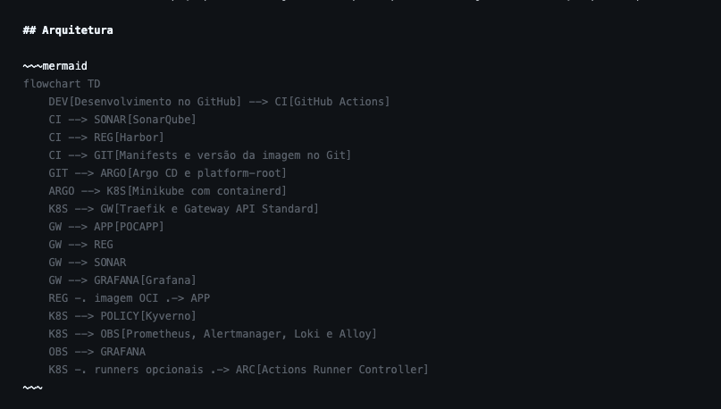

| Componente | Papel |
| --- | --- |
| Minikube e Docker | Kubernetes local de nó único. Perfis novos usam o driver Docker com runtime containerd |
| Argo CD e Helm | Reconciliam os manifests publicados em `main`. `platform-root` cria as Applications de Traefik, Harbor, SonarQube, Kyverno, políticas, rotas e POCAPP |
| Traefik e Gateway API | O listener HTTPS termina TLS. As `HTTPRoute` encaminham o tráfego entre namespaces |
| Harbor e SonarQube | Registry OCI e análise de código |
| Kyverno | Políticas de admissão declarativas. A regra bloqueia imagens sem tag explícita ou com `:latest` no namespace `apps`. [Política em Deny](infra/security/kyverno/disallow-latest.yaml) |
| Observabilidade | Prometheus e Alertmanager coletam métricas e avaliam alertas. Alloy coleta logs, Loki armazena e Grafana consulta os dados |
| SOPS e age | Backups criptografados de Secrets |
| ARC | Execução opcional de runners do GitHub Actions no cluster |

Comecei criando as Applications uma a uma. Hoje, a Application `platform-root` cria as aplicações da plataforma a partir do Git. O script instala a observabilidade em seguida e pode instalar o ARC, se solicitado. Quando o fluxo usa o Harbor, o runner precisa conseguir publicar a imagem, e o nó do Minikube precisa conseguir baixá-la. [Evidências da instalação](evidence/Provisionamento.md) · [Application raiz](infra/gitops/bootstrap/root-app.yaml)

## Provisionamento pelo script

### 1. Preparar a máquina

No ambiente em que testei a POC, usei macOS, Docker Desktop e Kubernetes `v1.37.0`. Antes de começar, instale Bash, Docker, Git, Minikube, `kubectl`, Helm, OpenSSL, `jq` e `yq` v4 de mikefarah, e deixe o Docker em execução. Se for restaurar os Secrets, tenha SOPS e a chave age dos backups à mão. Para seguir os passos manuais, instale também a CLI do Argo CD.

~~~bash
git clone https://github.com/fastII/pocdevopsmirante.git
cd pocdevopsmirante
bash scripts/provision-minikube.sh --help
~~~

Use um clone atualizado e confirme que o Git local tem acesso de leitura ao repositório. Antes de iniciar, o script compara os arquivos GitOps locais com a branch `main` que o Argo CD vai ler.

### 2. Instalar do zero ou restaurar os Secrets

**Instalação nova.** Informe seu usuário do GitHub ao iniciar o script. Ele sobe o Minikube, gera o certificado local e pede as credenciais que ainda faltam. Quando pedir o token do Argo CD, use um PAT com acesso de leitura ao repositório.

~~~bash
GITOPS_USERNAME=seu-usuario-github bash scripts/provision-minikube.sh --servir
~~~

Se você já tiver as credenciais, pode passá-las pelo ambiente com `GITOPS_TOKEN`, `HARBOR_ADMIN_PASSWORD`, `SONAR_MONITORING_PASSCODE` e `GRAFANA_PASSWORD`.

**Restauração em outra máquina ou reexecução.** Leve os arquivos `*.enc.yaml` e a chave age usada para abri-los. Mantenha a chave privada fora do Git e do Minikube. O script procura os backups em `infra/secrets` por padrão. Se estiverem em outra pasta, informe o caminho em `SECRETS_DIR`.

~~~bash
export SOPS_AGE_KEY_FILE="/caminho/seguro/chave.agekey"
export SECRETS_DIR="/caminho/seguro/backups-sops"
bash scripts/provision-minikube.sh --restaurar-secrets --servir
~~~

| Backup | Secret | Chaves |
| --- | --- | --- |
| `harbor.enc.yaml` | `harbor/harbor-admin` | `HARBOR_ADMIN_PASSWORD` |
| `sonarqube.enc.yaml` | `sonarqube/sonarqube-monitoring` | `monitoringPasscode` |
| `grafana.enc.yaml` | `observability/grafana-admin` | `admin-user`, `admin-password` |
| `gitops-repo.enc.yaml` | `argocd/provision-gitops-repo` | `type`, `url`, `username`, `password` |
| `arc.enc.yaml` | `arc-runners/arc-github-app` | `github_app_id`, `github_app_installation_id`, `github_app_private_key` |

Na restauração, o script reaplica as credenciais de cada backup e inclui o Secret do ARC se você passar `--com-arc`. Mesmo com o token do Argo CD restaurado, o Git da máquina continua usando suas próprias credenciais para consultar o remoto.

Um perfil novo começa com bancos e volumes vazios. Os backups SOPS recuperam as credenciais. Para recuperar também as imagens e os metadados do Harbor, o histórico do SonarQube ou os dashboards criados à mão, você precisa dos backups desses dados. Se a ideia é apenas desligar o laboratório e voltar depois, use `minikube -p minikube stop` e `minikube -p minikube start`. Confira seus backups antes de excluir um perfil, pois a exclusão apaga os dados locais.

### 3. Acompanhar a instalação e abrir as interfaces

O script começa pelo Minikube. Ele reaproveita o perfil quando já existe, habilita o Metrics Server e confere a StorageClass `standard`. Em seguida, instala o Argo CD, espera o `repo-server` ficar pronto e prepara os AppProjects, os CRDs da Gateway API Standard `v1.6.3`, o certificado e os Secrets.

Depois de aplicar `platform-root`, o script confere a revisão do Git e aguarda o Traefik, o Harbor, o SonarQube e as rotas. Ele também espera a API `ValidatingPolicy` do Kyverno. Se a política falhou porque a API ainda estava indisponível, o script pede ao Argo CD que tente de novo. A observabilidade sobe por padrão, mesmo enquanto a imagem da POCAPP ainda está sendo publicada.

Quando você usa `--servir`, o script deixa o encaminhamento aberto em `8443` para HTTPS e `8080` para HTTP. Mantenha o terminal aberto enquanto estiver usando esses endereços.

| Serviço | Acesso com `--servir` |
| --- | --- |
| Argo CD | `https://argocd.localhost:8443` |
| Harbor | `https://harbor.localhost:8443` |
| SonarQube | `http://sonarqube.localhost:8080` ou `https://sonarqube.localhost:8443` |
| Grafana | `https://grafana.localhost:8443` |
| POCAPP, quando a imagem estiver disponível | `https://healthz.localhost:8443/healthz` |

O certificado HTTPS do laboratório é autoassinado. Se precisar de portas dinâmicas, use `--acesso-corporativo` e consulte a porta HTTPS que o Minikube informar. Se preferir abrir só as portas fixas do Traefik depois, use o comando abaixo. Passe `--sem-observabilidade` para pular a stack ou `--com-arc` para instalar o runner no cluster. [Acesso no Minikube](https://minikube.sigs.k8s.io/docs/handbook/accessing/) · [TLS local](infra/certs/01-install-certs.md)

~~~bash
kubectl --context minikube -n traefik port-forward --address localhost svc/traefik 8443:443 8080:80
~~~

Na execução registrada abaixo, usei `--restaurar-secrets --servir` com um perfil Minikube que já existia. Quando o terminal mostrou **Provisionamento concluído**, o script deixou os encaminhamentos abertos para acessar os serviços.

Ver a execução do script, os pods no K9s e o painel do Argo CD

O script conferiu a revisão no GitHub e preparou o Minikube com o Metrics Server.

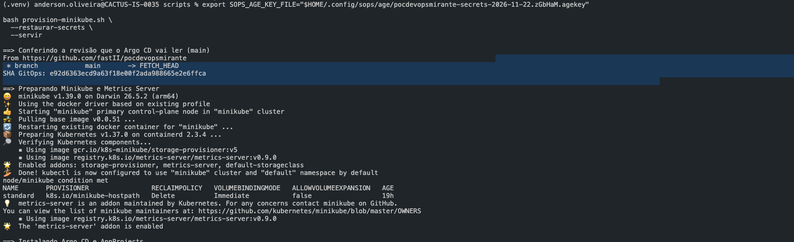

Em seguida, atualizou a instalação do Argo CD e preparou a Gateway API. O terminal mostra o reaproveitamento dos namespaces e o início da restauração dos Secrets.

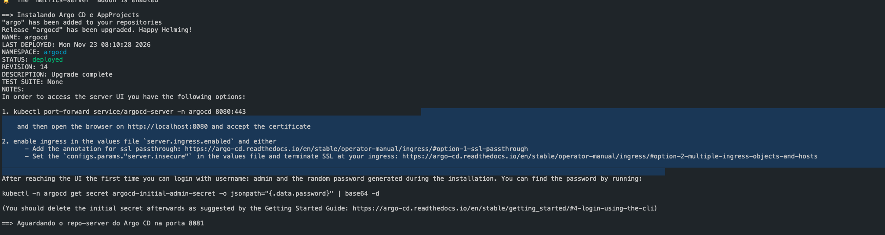

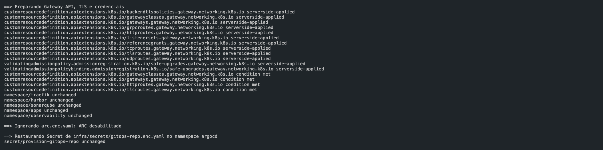

Ao final, o script listou os volumes e as rotas e anunciou os endereços locais.

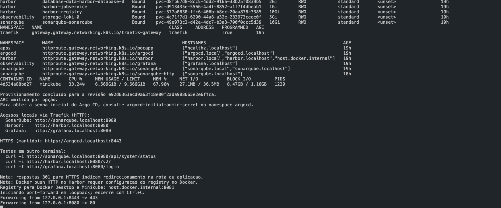

No K9s, abri a lista de pods por namespace. A captura mostra a POCAPP estável e a candidata em `Running`, junto com pods do Argo CD, Harbor, Kyverno e da observabilidade.

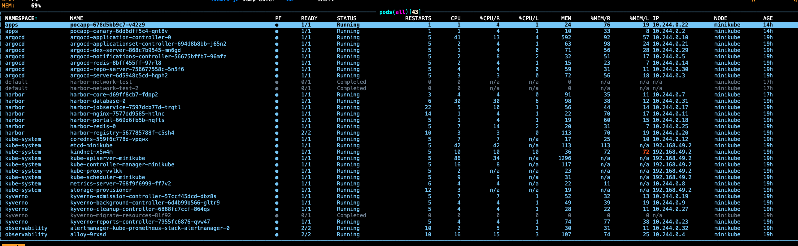

No painel do Argo CD, as 12 Applications estavam sincronizadas. A POCAPP estava entre as 11 com status `Healthy`. O Traefik estava sincronizado e ainda aparecia como `Progressing` no momento da captura.

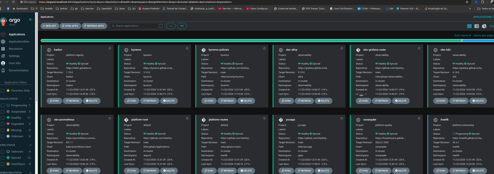

## Instalação manual

Se quiser acompanhar o que o script faz ou refazer uma etapa específica, siga o passo a passo abaixo.

Passos manuais do bootstrap ao Gateway

### 1. Iniciar o perfil

No Mac de 16 GiB que usei, comecei com 8 GiB no Docker Desktop. Com `no-limit`, é o Docker Desktop que define o teto de CPU e memória. A plataforma e os builds disputam esses recursos, então confira o consumo antes de rodar jobs no ARC. [Configurações do Docker Desktop](https://docs.docker.com/desktop/settings-and-maintenance/settings/) · [Auditoria e capacidade](evidence/Dificuldades.md)

~~~bash
docker info --format 'CPUs={{.NCPU}} RAM={{.MemTotal}}'
minikube -p minikube start --driver=docker --container-runtime=containerd \
  --kubernetes-version=v1.37.0 --cpus=no-limit --memory=no-limit
kubectl config use-context minikube
kubectl wait --for=condition=Ready node/minikube --timeout=180s
minikube -p minikube addons enable metrics-server
kubectl get storageclass standard
kubectl get --raw='/readyz?verbose'
~~~

### 2. Instalar o Argo CD

~~~bash
helm repo add argo https://argoproj.github.io/argo-helm --force-update
helm upgrade --install argocd argo/argo-cd --version 10.18.2 \
  -n argocd --create-namespace -f infra/gitops/helm-values/argocd-resources.yaml \
  --wait --timeout 10m
kubectl -n argocd rollout status deployment/argocd-repo-server --timeout=180s
kubectl apply -f infra/gitops/projects/
kubectl -n argocd get pods,appprojects
kubectl -n argocd port-forward svc/argocd-server 8090:80
~~~

Em outro terminal, obtenha a senha inicial com `argocd admin initial-password -n argocd` e autentique a CLI com `argocd login localhost:8090 --plaintext`. Troque a senha inicial após entrar. Configure o repositório privado no Argo CD com o PAT de leitura ou restaure o Secret do GitOps antes de aplicar `platform-root`. [Values do Argo CD](infra/gitops/helm-values/argocd-resources.yaml)

### 3. Preparar Gateway API, namespaces e credenciais

~~~bash
kubectl apply --server-side \
  -f https://github.com/kubernetes-sigs/gateway-api/releases/download/v1.6.3/standard-install.yaml
kubectl wait --for=condition=Established --timeout=120s \
  crd/gatewayclasses.gateway.networking.k8s.io \
  crd/gateways.gateway.networking.k8s.io \
  crd/httproutes.gateway.networking.k8s.io \
  crd/tlsroutes.gateway.networking.k8s.io
for ns in traefik harbor sonarqube apps observability; do
  kubectl create namespace "$ns" --dry-run=client -o yaml | kubectl apply -f -
done
~~~

| Dependência | Passo |
| --- | --- |
| TLS | Crie `traefik/local-selfsigned-tls` com SAN para `*.localhost` e `*.local`. [Certificado TLS](infra/certs/01-install-certs.md) |
| Harbor | Crie `harbor/harbor-admin`. [Senha do Harbor](infra/harbor/01-install-harbor.md#1-preparar-o-namespace-e-a-senha) |
| SonarQube | Crie `sonarqube/sonarqube-monitoring`. [Passcode do SonarQube](infra/sonarqube/01-install-sonarqube.md#1-preparar-o-secret-de-monitoramento) |
| Grafana | Crie `observability/grafana-admin` com `admin-user` e `admin-password` |
| Git privado | Configure o repositório na interface do Argo CD ou reaplique o backup correspondente |

A versão Standard inclui `TLSRoute v1`, API consultada pelo Traefik durante a inicialização. As rotas HTTPS da POC usam `HTTPRoute` e `experimentalChannel: false`. [Guia do Traefik](infra/traefik/01-install-traefik.md)

### 4. Aplicar App-of-Apps e aguardar a plataforma

~~~bash
git fetch origin main
git rev-parse HEAD origin/main
kubectl apply -f infra/gitops/bootstrap/root-app.yaml
argocd app wait platform-root --sync --timeout 240
kubectl -n argocd get applications

argocd app wait traefik --sync --timeout 480
kubectl -n traefik rollout status deployment/traefik --timeout=300s
kubectl wait --for=condition=Accepted gatewayclass/traefik --timeout=180s
kubectl -n traefik wait --for=condition=Programmed gateway/traefik-gateway --timeout=180s

argocd app wait harbor --sync --health --timeout 600
kubectl get --raw='/api/v1/namespaces/harbor/services/http:harbor:80/proxy/api/v2.0/health'
argocd app wait sonarqube --sync --health --timeout 600
argocd app wait platform-routes --sync --timeout 300
kubectl get httproute -A

argocd app wait kyverno --sync --health --timeout 480
kubectl wait --for=condition=Established crd/validatingpolicies.policies.kyverno.io --timeout=120s
kubectl get --raw /apis/policies.kyverno.io/v1
~~~

Se o Argo CD tentou aplicar `kyverno-policies` enquanto a API ainda estava subindo, espere `ValidatingPolicy` aparecer no resultado e rode `argocd app sync kyverno-policies`. Depois, aguarde com `argocd app wait kyverno-policies --sync --timeout 300`. Para confirmar que as rotas da plataforma foram aceitas e que suas referências existem, procure `Accepted=True` e `ResolvedRefs=True`. [Guia do Kyverno](infra/kyverno/01-install-kyverno.md)

### 5. Instalar ARC quando necessário

Se você quiser rodar jobs do GitHub Actions dentro do cluster, prepare o AppProject, os namespaces, o Secret da GitHub App e o repositório Helm OCI. Instale o controller e espere o rollout antes de criar o scale set. Para testar, confira o listener e dispare um job com o `runs-on` do scale set. É normal o ARC ficar sem pods de runner enquanto aguarda trabalho. [GitHub App](infra/gitops/arc-minikube/01-install-arc-github.md) · [Instalação e teste do ARC](infra/gitops/arc-minikube/README.md)

## Observabilidade

Depois da instalação, abra o Grafana pelo Traefik para ver o que acontece no cluster. O Prometheus coleta as métricas, o Alertmanager encaminha os alertas e o Alloy envia os logs dos pods para o Loki. No laboratório, o Prometheus usa intervalos de 60 segundos e guarda dois dias de métricas. O Loki guarda 48 horas de logs em um PVC de 5 GiB. [Values e validação da observabilidade](infra/gitops/observability-minikube/README.md)

O script já instala essa stack. Se estiver seguindo a instalação manual, confirme que o Gateway está pronto e que você já entrou na CLI do Argo CD. Rode os comandos na raiz do repositório. Eles criam o Secret do Grafana se ele ainda estiver ausente.

~~~bash
kubectl --context minikube create namespace observability --dry-run=client -o yaml |
  kubectl --context minikube apply -f -
if ! kubectl --context minikube -n observability get secret grafana-admin >/dev/null 2>&1; then
  read -rs -p 'Senha do Grafana: ' GRAFANA_PASSWORD
  kubectl --context minikube -n observability create secret generic grafana-admin \
    --from-literal=admin-user=admin --from-literal=admin-password="$GRAFANA_PASSWORD"
  unset GRAFANA_PASSWORD
fi

OBS=infra/gitops/observability-minikube/argocd
kubectl --context minikube apply -f "$OBS/project.yaml" -f "$OBS/prometheus.yaml" -f "$OBS/loki.yaml"
argocd app wait obs-prometheus obs-loki --sync --health --timeout 600
kubectl --context minikube apply -f "$OBS/alloy.yaml" -f "$OBS/grafana-route.yaml"
argocd app wait obs-alloy --sync --health --timeout 300
argocd app wait obs-grafana-route --sync --timeout 300
kubectl --context minikube -n observability describe httproute grafana
~~~

Para uma primeira checagem no Grafana, consulte `up` no Prometheus e `{namespace="argocd"}` no Loki. Se os logs não aparecerem, confira os pods e os logs do Alloy. Se a interface não abrir, veja se a rota do Grafana mostra `Accepted=True` e `ResolvedRefs=True`.

Ver métricas e logs no Grafana

### Alerta da POCAPP no Grafana

Criei a regra **POCAPP sem réplicas disponíveis** no grupo `pocapp` da pasta **POCAPP**. A cada minuto, o Grafana consulta o Prometheus para contar as réplicas disponíveis do Deployment `pocapp` no namespace `apps`. Se o valor ficar abaixo de uma réplica por dois minutos, a regra dispara e encaminha o alerta ao contact point `alertmanager-minikube`.

Ver a criação e o estado da regra de alerta

A pasta **POCAPP** reúne as regras da aplicação. Usei o UID dessa pasta para enviar a regra em JSON pela API de Alerting do Grafana.

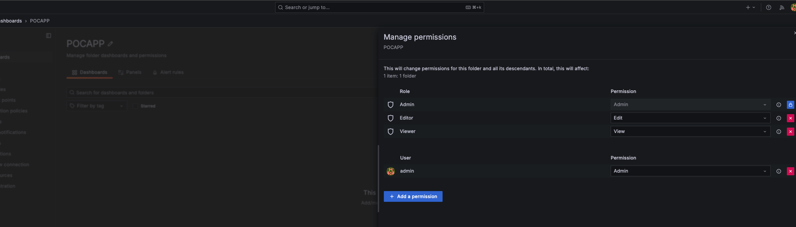

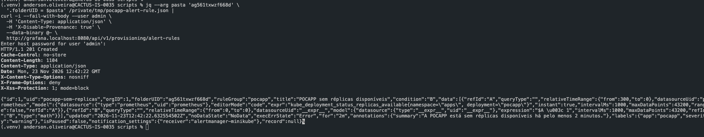

Em **Alerting → Alert rules**, a regra apareceu como **Normal**, com a avaliação saudável no momento da captura.

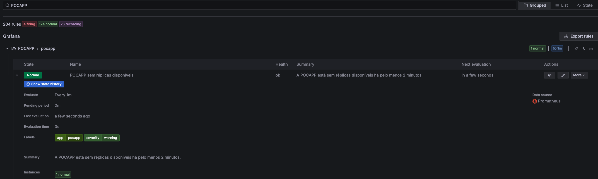

## POCAPP e CI/CD

### Imagem e execução local

A POCAPP é uma API Node.js que responde em `/healthz`. O endpoint serve às sondagens do Kubernetes e mostra qual versão respondeu, o que ajuda a demonstrar o canary. O código está em `app/` e o Argo CD instala o chart em `helm/pocapp/`. No Deployment estável, reservei 25m de CPU e 32 MiB de memória, com limites de 100m e 128 MiB. [Application da POCAPP](infra/gitops/applications/pocapp.yaml) · [Values da POCAPP](helm/pocapp/values.yaml)

O cache de imagens começa vazio quando você cria um perfil. O caminho normal é deixar o pipeline construir e entregar a imagem. Se você já tiver um arquivo OCI ou Docker, pode carregá-lo no provisionamento com `POCAPP_IMAGE_ARCHIVE` e política `IfNotPresent` ou `Never`. Para usar um registry privado, informe `POCAPP_DOCKER_CONFIG` e declare o Secret em `imagePullSecrets`.

Executar a POCAPP separadamente

Use Node.js 20 ou superior e execute na raiz do repositório.

~~~bash
helm lint helm/pocapp
helm template pocapp helm/pocapp -n apps
npm --prefix app start
~~~

Em outro terminal, `curl -i http://127.0.0.1:3000/healthz` deve retornar HTTP 200 e `healthy`. Para empacotar o chart, use `helm package helm/pocapp`.

Se quiser construir a imagem dentro do Minikube para um teste local, use o repositório e a tag que estão em `main`. O exemplo usa a referência inicial do chart.

~~~bash
minikube -p minikube image build -t healthz-api:1.0.0 ./app
minikube -p minikube image ls
~~~

Para acompanhar um deploy da aplicação isoladamente, use `argocd app wait pocapp --sync --health --timeout 300`, `kubectl -n apps rollout status deployment/pocapp` e `kubectl -n apps describe httproute pocapp`. Para acessar direto, abra `kubectl -n apps port-forward svc/pocapp 3000:80`. Testes externos ao Argo CD devem usar um release Helm em ambiente isolado.

### Configurar o CI/CD

| Variável ou Secret | Uso |
| --- | --- |
| `SONAR_TOKEN` | Secret de análise do projeto no SonarQube |
| `SONAR_HOST_URL` | URL alcançável pelo runner. Para o runner na máquina do Minikube, deixe vazia para o job abrir um túnel HTTP próprio. A configuração antiga em `https://sonarqube.localhost:8443` também aciona o túnel |
| `HARBOR_REGISTRY` e `HARBOR_PROJECT` | Registry canônico em formato `hostname[:porta]` e projeto de imagens no modo `harbor` |
| `HARBOR_USERNAME` e `HARBOR_PASSWORD` | Secrets de publicação |
| `POCAPP_IMAGE_PLATFORM` | Padrão `linux/arm64`. Use `linux/amd64` no nó Intel/AMD |
| `POCAPP_IMAGE_DELIVERY` | Define o modo padrão de entrega do workflow |

O runner hospedado pelo GitHub constrói a imagem e gera o relatório do Trivy. A análise do SonarQube e a entrega da imagem rodam no runner `self-hosted`, que alcança os serviços locais. Na máquina do runner, tenha `kubectl`, `jq` e acesso ao contexto `minikube`. No SonarQube, crie o projeto `pocapp` e gere o token de análise. [SonarQube](infra/sonarqube/01-install-sonarqube.md#3-conectar-ao-pipeline) · [Workflow da POCAPP](.github/workflows/pocapp-ci-cd.yaml)

Na configuração local padrão, o scanner e o Quality Gate usam o mesmo túnel em `http://127.0.0.1:<porta-dinâmica>`. Se preferir passar pelo Traefik com o runner na mesma máquina, mantenha `--servir` ativo e defina `SONAR_HOST_URL=http://sonarqube.localhost:8080`. Para um runner em outra máquina, use HTTPS com um certificado em que ele confie.

- **Entrega local.** Em **Actions → POCAPP - CI & CD → Run workflow**, selecione `main`, `deploy_target: stable` e `image_delivery: minikube-local`. O runner carrega o artefato no perfil antes de publicar a tag no Git. Preserve o arquivo se precisar reconstruir o ambiente.
- **Entrega via Harbor local.** No Docker Desktop, adicione `host.docker.internal:8081` a `insecure-registries` e mantenha `--servir` em execução na máquina do runner. Configure `HARBOR_REGISTRY=host.docker.internal:8081` e `HARBOR_PROJECT=poc`. O provisionador abre HTTP direto ao Harbor em `8081` e configura o containerd para esse endereço. A interface do Harbor usa o Traefik em `8080` ou `8443`. O projeto público permite pull anônimo e o push exige uma credencial com permissão de escrita. Para imagens privadas, configure `imagePullSecrets` no namespace `apps`. [Configuração do Harbor](infra/harbor/01-install-harbor.md#3-preparar-o-registry-para-a-aplicação)

### Testes com Yarn e cobertura no SonarQube

No pipeline, o job de validação ativa o Yarn Classic `1.22.22` com Corepack e roda `yarn install --frozen-lockfile` e `yarn test:coverage` na pasta `app`. O Vitest mede a cobertura com o V8 e exige pelo menos 80% em linhas, funções, ramificações e instruções. O job publica `app/coverage/lcov.info` no artefato `pocapp-coverage`. O job de análise baixa esse artefato, envia a cobertura ao SonarQube e aguarda o Quality Gate. [Configuração do Vitest](app/vitest.config.js) · [Workflow da POCAPP](.github/workflows/pocapp-ci-cd.yaml)

Ver as capturas da configuração e do resultado dos testes

O exemplo da SonarSource mostra como gerar o LCOV com Yarn e Jest. Na POCAPP, usei o mesmo formato de relatório com Vitest.

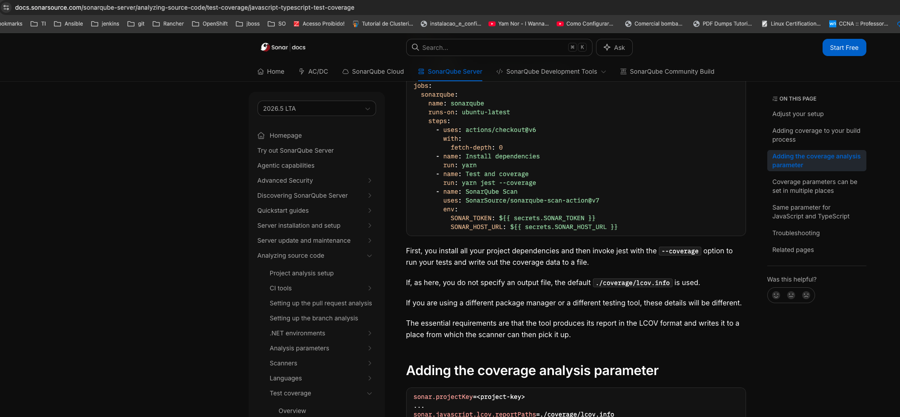

As capturas seguintes mostram a configuração inicial do Vitest e o teste local que fiz com `npm run test:coverage`. Os sete testes passaram. No GitHub Actions, `yarn test:coverage` roda o mesmo script do `package.json`.

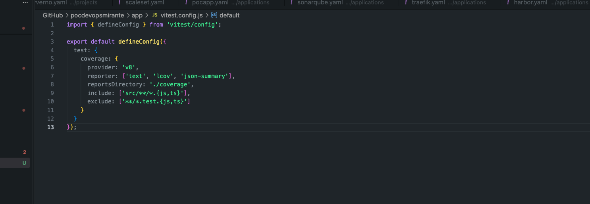

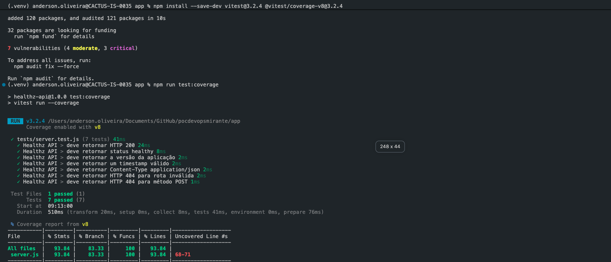

No SonarQube, a análise de `pocapp` mostrou **93,0% de cobertura** e o Quality Gate aprovado nessa execução.

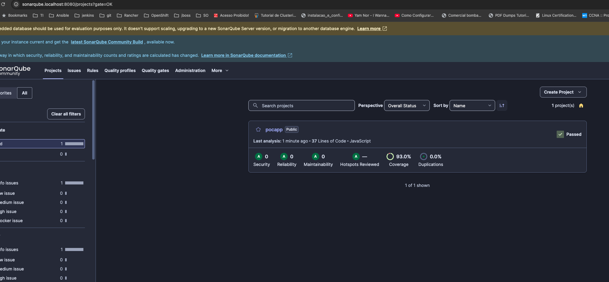

#### Referências de consulta

- [SonarSource — cobertura de testes para JavaScript e TypeScript](https://docs.sonarsource.com/sonarqube-server/analyzing-source-code/test-coverage/javascript-typescript-test-coverage)
- [Baeldung — cobertura com SonarQube e JaCoCo em projetos Java](https://www.baeldung.com/sonarqube-jacoco-code-coverage)
- [GitHub Marketplace — Coverage History Action](https://github.com/marketplace/actions/coverage-history-action)
- [GitHub Marketplace — Test Coverage Annotations](https://github.com/marketplace/actions/test-coverage-annotations)

### Escolher os inputs do pipeline

Para rodar o pipeline manualmente, abra **Actions → POCAPP - CI & CD → Run workflow** e selecione `main`. O formulário faz duas perguntas. Qual versão você quer atualizar e por onde o Minikube vai receber a imagem?

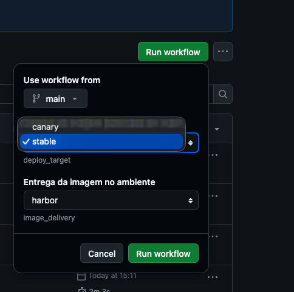

| Input | Opção | Efeito |
| --- | --- | --- |
| `deploy_target` | `stable` | Atualiza a imagem da versão estável em `image` |
| `deploy_target` | `canary` | Registra a nova imagem em `canary.image`, inicia a candidata e mantém o peso em `0` |
| `image_delivery` | `harbor` | Publica a imagem no repositório configurado e registra a referência no Git |
| `image_delivery` | `minikube-local` | Carrega a imagem no nó do Minikube e registra a referência local no Git |

Na captura, o formulário está pronto para atualizar a versão estável usando o Harbor. Para demonstrar um canary, escolha `canary` e mantenha `harbor`. Comece com `canary.enabled: false` e use uma candidata com tag diferente da estável. Depois que a imagem for publicada, o job GitOps registra a tag da candidata e o Argo CD sobe seus pods com peso `0` na rota.

Onde aparece a nova tag? Depois de validar o código e o chart, passar pelo Quality Gate e entregar a imagem, o job **GitOps - Atualizar imagem no Helm** grava a referência em `main`. A tag segue o formato `sha-<12 primeiros caracteres do commit>`. O Argo CD aplica essa revisão e o campo `version` do `/healthz` mostra a tag que chegou ao Deployment.

Quando um push em `main` dispara o workflow, o destino padrão é `stable`. Alterações só em `helm/pocapp/values.yaml`, como o ajuste de peso do canary, vão direto para o Argo CD sem disparar outro build. [Workflow de CI/CD](.github/workflows/pocapp-ci-cd.yaml)

### Resumo da execução

Quando a execução terminar, abra a aba **Summary**. Ali você consegue ver até onde o pipeline chegou, qual imagem entregou e qual revisão publicou no Git. Se alguma etapa falhar, o resumo marca a falha e indica quais jobs foram ignorados. Para confirmar que a versão entrou no ar, abra a POCAPP no Argo CD e confira a sincronização e a saúde da aplicação.

Na execução abaixo, os seis jobs ficaram verdes em 2 min 33 s. O pipeline publicou a imagem `sha-4745f28c1159` no Harbor para o destino `stable` e registrou a atualização na revisão GitOps `4e6054b43b59`.

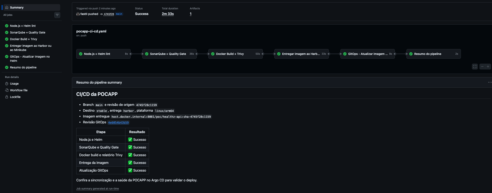

### Canary com Traefik

1. **Estabeleça a referência.** Comece com `canary.enabled: false`. Confirme a imagem estável e registre repositório, tag e política de pull. Preserve o artefato para o rollback.
2. **Prepare a candidata.** Execute o workflow com `deploy_target=canary` e a entrega escolhida. Confira o commit `ci(pocapp): deploy canary image ...` em `main`. O chart cria Deployment e Service separados para a candidata e a rota continua com 100% na estável. Enquanto o canary está ativo, o job GitOps recusa outro deploy.
3. **Valide com peso zero.** Aguarde o rollout de `deployment/pocapp-canary`. Em outro terminal, abra `kubectl --context minikube -n apps port-forward svc/pocapp-canary 3001:80` e confira a tag em `curl -fsS http://127.0.0.1:3001/healthz | jq -r '.version'`.
4. **Demonstre o tráfego.** Publique `canary.weight: 10` em `helm/pocapp/values.yaml`, aguarde a reconciliação e confira os pesos e as condições `Accepted=True` e `ResolvedRefs=True` no `HTTPRoute`. A amostra abaixo deve mostrar as duas tags, com aproximadamente 90% das requisições na estável e 10% na candidata. [Divisão de tráfego no Gateway API](https://gateway-api.sigs.k8s.io/guides/user-guides/traffic-splitting/)

~~~bash
kubectl --context minikube -n apps get httproute pocapp -o json |
  jq '.spec.rules[].backendRefs, .status.parents[].conditions'

set -o pipefail
PORTA_HTTPS=8443
for i in $(seq 1 100); do
  curl -fkSs --noproxy '*' --resolve "healthz.localhost:$PORTA_HTTPS:127.0.0.1" \
    "https://healthz.localhost:$PORTA_HTTPS/healthz" | jq -er '.version' || exit 1
done | sort | uniq -c
~~~

Em um teste isolado no Minikube, o peso `10` produziu 90 respostas da estável e 10 da candidata em 100 requisições. As duas tags usavam o mesmo artefato para validar o roteamento. O teste também confirmou o aborto, a promoção e o retorno à tag estável pelo rollback.

### Promover, abortar ou restaurar

- **Promover a candidata.** Publique `canary.weight: 100` e valide a candidata pelo Traefik. Copie seu repositório, tag e política de pull efetiva para `image`, mantendo o peso em 100 durante o rollout da estável. Aguarde `deployment/pocapp` ficar pronto com a nova imagem. Publique peso zero, confira a resposta pela estável e publique `canary.enabled: false` para remover a candidata.
- **Abortar durante o canary.** Se a estável ainda está com a imagem anterior, publique peso zero e confirme que ela voltou a receber todo o tráfego. Se a estável já mudou durante a promoção, restaure sua referência anterior e aguarde o rollout antes de devolver o tráfego. Desabilite o canary depois de validar a estável.
- **Restaurar após finalizar o canary.** Em **Actions → Rollback POCAPP → Run workflow**, selecione `main` e informe `image_tag` da última versão saudável. Preencha `image_repository` se ela veio de outro repositório e selecione `image_pull_policy` se a política também mudou. Confirme a existência do artefato no Harbor ou no nó do Minikube antes de executar. Acompanhe o commit `rollback(pocapp): restore image ...` e a revisão no Argo CD. Após o rollout, aguarde até que requisições consecutivas pelo Traefik retornem a tag restaurada. [Procedimento de rollback](evidence/Processorollback.md) · [Workflow de rollback](.github/workflows/rollback-pocapp.yaml)

## Dificuldades

| Sintoma | Causa observada e correção |
| --- | --- |
| `GatewayClass` e Gateway sem condição pronta | O Traefik consultava `TLSRoute v1`, que faltava no bundle Standard `v1.4.1`. O bootstrap passou a instalar o bundle Standard `v1.6.3` |
| `Progressing` no Traefik com mensagem de CRD Hub | O CRD chegou a `Established` e o Traefik a `Synced`. Um autosync posterior substituía o identificador do sync manual. O script passou a acompanhar o estado do Argo CD e a validar diretamente o Deployment, o GatewayClass e o Gateway |
| `connection refused` na porta `8081` do Argo CD | Sondagens curtas levaram a reinícios do `repo-server`. O bootstrap espera um endpoint pronto e solicita uma atualização do `platform-root` |
| SonarScanner em `8443` com `The certificate chain is not trusted` | O runner recebeu o certificado autoassinado do Traefik. Retirei o redirecionamento do listener HTTP nos values e habilitei uma rota HTTP local para o SonarQube. O pipeline usa um túnel HTTP próprio em loopback para a análise e o Quality Gate. [Diagnóstico](evidence/Dificuldades.md#7-certificado-autoassinado-no-sonarqube) |
| Harbor com `Dirty database version 4` | Uma migração foi interrompida. A recuperação usou backup criptografado, conferiu o esquema e reaplicou o SQL oficial em transação. Ajustes no Argo CD preservam os Secrets aleatórios e evitam que rerenders reiniciem os pods |
| Push HTTP no Harbor e pull pelo Minikube | Pelo Traefik, o daemon Docker tentava HTTPS e recebia `404`. A porta `8081` passou a encaminhar diretamente ao Service do Harbor. O containerd usa HTTP para o mesmo endereço e o túnel permanece ativo durante o deploy |
| Kyverno saudável e política `OutOfSync` | A política tentou sincronizar antes da disponibilidade de `ValidatingPolicy v1`. O Argo CD esgotou as tentativas da revisão. O script agora espera a descoberta da API e solicita uma nova tentativa específica |
| Helm falha com `defina canary.image.tag` | O canary foi habilitado no Git com a tag da candidata vazia. Comece com `canary.enabled: false` e use `deploy_target=canary` para registrar a imagem. Ajuste o peso depois que a candidata estiver pronta |
| Timeouts do etcd, containerd e probes | O ambiente mostrou alta pressão de CPU e memória durante a observabilidade e os jobs ARC. A auditoria registrou 7,10 GiB em um limite de 8 GiB. Uma coleta posterior registrou processos encerrados por OOM. Foram ajustados recursos, sondagens e retenção |
| `ImagePullBackOff` no primeiro deploy | A imagem `healthz-api:1.0.0` faltava no cache do containerd. O pipeline passou a entregar pelo Harbor ou carregar o artefato no nó. A plataforma segue com a instalação da observabilidade |
| Acesso sem sudo no Mac corporativo | `minikube tunnel` demandava portas privilegiadas. O encaminhamento HTTPS do script usa a porta local `8443`. `--acesso-corporativo` permite usar as portas dinâmicas do Minikube |

Registrei nas evidências o que medi, as tentativas que fiz e a sequência que usei para recuperar o ambiente. Se você estiver usando outra máquina, compare os números sob a sua carga antes de adotar os mesmos limites de recursos. [Dificuldades e medições](evidence/Dificuldades.md) · [Capturas e procedimentos](evidence/Provisionamento.md#9-incidentes-de-provisionamento)

### Diagnosticar um timeout

Se o script parar em um timeout, comece pela última etapa que apareceu no terminal. Veja a fase e os eventos da Application correspondente, anote o SHA que o Argo CD tentou aplicar e confira os PVCs. Se suspeitar de pressão no nó e o Metrics Server estiver indisponível, confira o Docker e o `/readyz` primeiro.

~~~bash
docker stats --no-stream minikube
kubectl --context minikube --request-timeout=10s get --raw='/readyz?verbose'
kubectl --context minikube -n argocd get applications
kubectl --context minikube get gatewayclass
kubectl --context minikube get gateway,httproute -A
kubectl --context minikube -n observability get pods,pvc
kubectl --context minikube get events -A --sort-by=.lastTimestamp
kubectl --context minikube top pods -A --sort-by=memory
~~~

## Melhorias

### Implementadas

- Bootstrap reexecutável, recuperação de credenciais com SOPS e age, verificação da revisão GitOps e acesso HTTPS local via Traefik.
- Ajustes de `requests` e `limits` dos controladores, Redis, banco e serviços auxiliares. O ARC usa um runner simultâneo. As sondagens do Harbor e do Argo CD têm janelas maiores para recuperação sob pressão. [Medições e mudanças por componente](evidence/Dificuldades.md#3-mudanças-no-git-e-validação)
- Retenção do PVC do Loki ao reduzir réplicas, intervalos padrão de 60 segundos no Prometheus e validação das rotas antes de informar conclusão. [Values do Loki](infra/gitops/observability-minikube/values/loki.yaml)
- Build e scan fora do bootstrap, entrega de imagem pelo runner e promoção ou rollback da versão pelo Git. [Workflow](.github/workflows/pocapp-ci-cd.yaml)

### Próximas evoluções

- Proteger `main` com revisão e checks de Node.js e Helm. Primeiro adapte CI/CD e rollback para publicar mudanças de tag ou digest em branches com PR. Mantenha a validação nas mudanças GitOps e restrinja o disparo de builds a alterações que precisam de nova imagem. Os workflows atuais escrevem diretamente em `main`. [Branch protection](https://docs.github.com/en/repositories/configuring-branches-and-merges-in-your-repository/managing-rulesets/available-rules-for-rulesets)
- Medir latência, erros, throttling, consumo de memória e armazenamento sob carga. Dimensionar retenção, cardinalidade e réplicas com base nas medições. Evoluir para alertas por sintomas e objetivos de confiabilidade.
- Exercitar a recuperação de bancos, registries e dashboards em perfis isolados. Registrar os tempos de recuperação, as dependências e o resultado de cada restauração.
- Ampliar os controles de cadeia de suprimentos com imagens imutáveis, validação de assinaturas e políticas de admissão após observar os relatórios de auditoria.
- Experimentar agentes com acesso somente leitura a Kubernetes e Prometheus para correlacionar métricas, eventos e logs. As mudanças operacionais exigem evidências e revisão humana.
