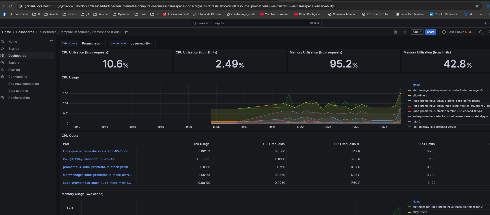
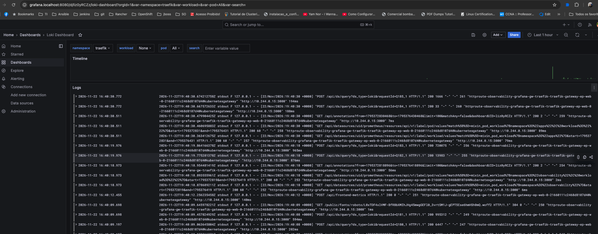
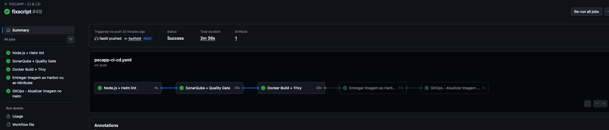

# POC DevOps Mirante

Montei esta POC para reproduzir, em um Kubernetes local, as integrações entre infraestrutura, entrega contínua, segurança e observabilidade. O laboratório permite experimentar, investigar causas de falhas e documentar como recuperar a plataforma em outra máquina.

- [Arquitetura](#arquitetura)
- [Provisionamento pelo script](#provisionamento-pelo-script)
- [Instalação manual](#instalação-manual)
- [Observabilidade](#observabilidade)
- [POCAPP e CI/CD](#pocapp-e-cicd)
- [Dificuldades](#dificuldades)
- [Melhorias](#melhorias)

## Por que resolvi construir esta POC

Desafios técnicos como este são importantes para quem trabalha com TI. Eles nos tiram do ambiente confortável, permitem testar novas tecnologias com autonomia e mostram, na prática, os detalhes que não aparecem em um diagrama de arquitetura.

Minha proposta foi montar uma plataforma Kubernetes local, próxima dos conceitos utilizados em ambientes corporativos, com a liberdade de experimentar, investigar, corrigir e evoluir. Quis entender como as ferramentas se integram e quais decisões tornam a operação mais simples, segura e previsível.

## Arquitetura

~~~mermaid
flowchart TD
    DEV[Desenvolvimento no GitHub] --> CI[GitHub Actions]
    CI --> SONAR[SonarQube]
    CI --> REG[Harbor]
    CI --> GIT[Manifests e versão da imagem no Git]
    GIT --> ARGO[Argo CD e platform-root]
    ARGO --> K8S[Minikube com containerd]
    K8S --> GW[Traefik e Gateway API Standard]
    GW --> APP[POCAPP]
    GW --> REG
    GW --> SONAR
    GW --> GRAFANA[Grafana]
    REG -. imagem OCI .-> APP
    K8S --> POLICY[Kyverno]
    K8S --> OBS[Prometheus, Alertmanager, Loki e Alloy]
    OBS --> GRAFANA
    K8S -. runners opcionais .-> ARC[Actions Runner Controller]
~~~

| Componente | Papel |
| --- | --- |
| Minikube e Docker | Kubernetes local de nó único. Perfis novos usam o driver Docker com runtime containerd |
| Argo CD e Helm | Reconciliam os manifests publicados em `main`. `platform-root` cria as Applications de Traefik, Harbor, SonarQube, Kyverno, políticas, rotas e POCAPP |
| Traefik e Gateway API | O listener HTTPS termina TLS. As `HTTPRoute` encaminham o tráfego entre namespaces |
| Harbor e SonarQube | Registry OCI e análise de código |
| Kyverno | Políticas de admissão declarativas. A regra bloqueia imagens sem tag explícita ou com `:latest` no namespace `apps`. [Política em Deny](infra/security/kyverno/disallow-latest.yaml) |
| Observabilidade | Prometheus e Alertmanager coletam métricas e avaliam alertas. Alloy coleta logs, Loki armazena e Grafana consulta os dados |
| SOPS e age | Backups criptografados de Secrets |
| ARC | Execução opcional de runners do GitHub Actions no cluster |

A instalação original usou Applications separadas. A instalação atual usa App-of-Apps para a plataforma e bootstrap separado para observabilidade e ARC. O diagrama mostra os modos de integração da POC. A entrega completa via Harbor depende de conectividade, TLS e credenciais na máquina do runner e no runtime do nó. [Evidências da instalação](evidence/Provisionamento.md) · [Application raiz](infra/gitops/bootstrap/root-app.yaml)

## Provisionamento pelo script

### 1. Preparar a máquina

Instale Bash, Docker, Git, Minikube, `kubectl`, Helm, OpenSSL, `jq` e `yq` v4 de mikefarah. Inicie o Docker. Para restaurar credenciais, tenha também SOPS e a chave age que abre os backups. Para a instalação manual, use a CLI do Argo CD. A referência testada usa macOS, Docker Desktop e Kubernetes `v1.37.0`. O Git local precisa de acesso de leitura à revisão remota.

~~~bash
git clone https://github.com/fastII/pocdevopsmirante.git
cd pocdevopsmirante
bash scripts/provision-minikube.sh --help
~~~

Use uma cópia atualizada do repositório. As aplicações leem os manifests em `main`. O script confere os arquivos GitOps do clone com o remoto antes de iniciar.

### 2. Instalar do zero ou restaurar os Secrets

**Instalação nova.** O script inicia o perfil, gera o certificado local e solicita as credenciais ausentes. Use o usuário do GitHub para iniciar o prompt de token HTTPS do Argo CD. O PAT precisa de acesso de leitura ao repositório.

~~~bash
GITOPS_USERNAME=seu-usuario-github bash scripts/provision-minikube.sh --servir
~~~

Para automatizar os prompts, o script aceita `GITOPS_TOKEN`, `HARBOR_ADMIN_PASSWORD`, `SONAR_MONITORING_PASSCODE` e `GRAFANA_PASSWORD`. Forneça-os pelo ambiente.

**Restauração em outra máquina ou reexecução.** Copie os backups `*.enc.yaml` e mantenha a chave privada fora do Git e do Minikube. O diretório padrão é `infra/secrets`. Use `SECRETS_DIR` para apontar para outro local.

~~~bash
export SOPS_AGE_KEY_FILE="/caminho/seguro/chave.agekey"
export SECRETS_DIR="/caminho/seguro/backups-sops"
bash scripts/provision-minikube.sh --restaurar-secrets --servir
~~~

| Backup | Secret | Chaves |
| --- | --- | --- |
| `harbor.enc.yaml` | `harbor/harbor-admin` | `HARBOR_ADMIN_PASSWORD` |
| `sonarqube.enc.yaml` | `sonarqube/sonarqube-monitoring` | `monitoringPasscode` |
| `grafana.enc.yaml` | `observability/grafana-admin` | `admin-user`, `admin-password` |
| `gitops-repo.enc.yaml` | `argocd/provision-gitops-repo` | `type`, `url`, `username`, `password` |
| `arc.enc.yaml` | `arc-runners/arc-github-app` | `github_app_id`, `github_app_installation_id`, `github_app_private_key` |

Cada arquivo guarda um manifesto `Secret`. A restauração reaplica os valores presentes no backup. O Secret do ARC só é restaurado com `--com-arc`. O Git local usa a própria autenticação, inclusive quando o PAT do Argo CD vem do backup.

Um perfil novo cria bancos e volumes vazios. Backups SOPS recuperam credenciais. As imagens e os metadados do Harbor, o histórico do SonarQube e os dashboards criados à mão exigem backups próprios. Para preservar o perfil atual, use `minikube -p minikube stop` e depois `minikube -p minikube start`. Excluir o perfil apaga seus dados locais. Confira os backups antes de reconstruir na mesma máquina.

### 3. Acompanhar a instalação e abrir as interfaces

1. O script inicia ou reutiliza o Minikube, habilita o Metrics Server e confere a StorageClass `standard`.
2. Instala o Argo CD, aguarda o `repo-server` e aplica os AppProjects.
3. Instala os CRDs da Gateway API `v1.6.3` Standard e prepara TLS e Secrets.
4. Aplica `platform-root` e confirma a revisão. Aguarda o Traefik, Harbor, SonarQube e as rotas.
5. Aguarda o Kyverno e a API `ValidatingPolicy`. Se a política já tiver falhado especificamente por falta dessa API, solicita uma tentativa após a API ficar disponível.
6. Instala a observabilidade por padrão. ARC é opcional. O deploy da POCAPP segue pelo Argo CD e a observabilidade pode subir enquanto a imagem ainda é publicada.
7. Com `--servir`, abre as portas locais `8443` para HTTPS e `8080` para HTTP. Mantenha o terminal aberto durante o uso.

| Serviço | Acesso com `--servir` |
| --- | --- |
| Argo CD | `https://argocd.localhost:8443` |
| Harbor | `https://harbor.localhost:8443` |
| SonarQube | `http://sonarqube.localhost:8080` ou `https://sonarqube.localhost:8443` |
| Grafana | `https://grafana.localhost:8443` |
| POCAPP, quando a imagem estiver disponível | `https://healthz.localhost:8443/healthz` |

O certificado local é autoassinado. Use `--acesso-corporativo` para abrir um túnel com portas dinâmicas e consulte a porta HTTPS anunciada pelo Minikube. Para abrir a porta fixa depois, execute o `port-forward` abaixo. Use `--sem-observabilidade` para uma instalação mais leve e `--com-arc` para instalar o runner no cluster. [Acesso no Minikube](https://minikube.sigs.k8s.io/docs/handbook/accessing/) · [TLS local](infra/certs/01-install-certs.md)

~~~bash
kubectl --context minikube -n traefik port-forward --address localhost svc/traefik 8443:443 8080:80
~~~

## Instalação manual

Passos manuais do bootstrap ao Gateway

### 1. Iniciar o perfil

Em um Mac com 16 GiB, a referência de partida foi 8 GiB no Docker Desktop. A stack com builds pode exigir mais memória conforme o uso do host. `no-limit` deixa o teto de recursos no Docker Desktop. Consulte o consumo efetivo antes de executar jobs ARC. [Configurações do Docker Desktop](https://docs.docker.com/desktop/settings-and-maintenance/settings/) · [Auditoria e capacidade](evidence/Dificuldades.md)

~~~bash
docker info --format 'CPUs={{.NCPU}} RAM={{.MemTotal}}'
minikube -p minikube start --driver=docker --container-runtime=containerd \
  --kubernetes-version=v1.37.0 --cpus=no-limit --memory=no-limit
kubectl config use-context minikube
kubectl wait --for=condition=Ready node/minikube --timeout=180s
minikube -p minikube addons enable metrics-server
kubectl get storageclass standard
kubectl get --raw='/readyz?verbose'
~~~

### 2. Instalar o Argo CD

~~~bash
helm repo add argo https://argoproj.github.io/argo-helm --force-update
helm upgrade --install argocd argo/argo-cd --version 10.18.2 \
  -n argocd --create-namespace -f infra/gitops/helm-values/argocd-resources.yaml \
  --wait --timeout 10m
kubectl -n argocd rollout status deployment/argocd-repo-server --timeout=180s
kubectl apply -f infra/gitops/projects/
kubectl -n argocd get pods,appprojects
kubectl -n argocd port-forward svc/argocd-server 8090:80
~~~

Em outro terminal, obtenha a senha inicial com `argocd admin initial-password -n argocd` e autentique a CLI com `argocd login localhost:8090 --plaintext`. Troque a senha inicial após entrar. Configure o repositório privado no Argo CD com o PAT de leitura ou restaure o Secret do GitOps antes de aplicar `platform-root`. [Values do Argo CD](infra/gitops/helm-values/argocd-resources.yaml)

### 3. Preparar Gateway API, namespaces e credenciais

~~~bash
kubectl apply --server-side \
  -f https://github.com/kubernetes-sigs/gateway-api/releases/download/v1.6.3/standard-install.yaml
kubectl wait --for=condition=Established --timeout=120s \
  crd/gatewayclasses.gateway.networking.k8s.io \
  crd/gateways.gateway.networking.k8s.io \
  crd/httproutes.gateway.networking.k8s.io \
  crd/tlsroutes.gateway.networking.k8s.io
for ns in traefik harbor sonarqube apps observability; do
  kubectl create namespace "$ns" --dry-run=client -o yaml | kubectl apply -f -
done
~~~

| Dependência | Passo |
| --- | --- |
| TLS | Crie `traefik/local-selfsigned-tls` com SAN para `*.localhost` e `*.local`. [Certificado TLS](infra/certs/01-install-certs.md) |
| Harbor | Crie `harbor/harbor-admin`. [Senha do Harbor](infra/harbor/01-install-harbor.md#1-preparar-o-namespace-e-a-senha) |
| SonarQube | Crie `sonarqube/sonarqube-monitoring`. [Passcode do SonarQube](infra/sonarqube/01-install-sonarqube.md#1-preparar-o-secret-de-monitoramento) |
| Grafana | Crie `observability/grafana-admin` com `admin-user` e `admin-password` |
| Git privado | Configure o repositório na interface do Argo CD ou reaplique o backup correspondente |

A versão Standard inclui `TLSRoute v1`, API consultada pelo Traefik durante a inicialização. As rotas HTTPS da POC usam `HTTPRoute` e `experimentalChannel: false`. [Guia do Traefik](infra/traefik/01-install-traefik.md)

### 4. Aplicar App-of-Apps e aguardar a plataforma

~~~bash
git fetch origin main
git rev-parse HEAD origin/main
kubectl apply -f infra/gitops/bootstrap/root-app.yaml
argocd app wait platform-root --sync --timeout 240
kubectl -n argocd get applications

argocd app wait traefik --sync --timeout 480
kubectl -n traefik rollout status deployment/traefik --timeout=300s
kubectl wait --for=condition=Accepted gatewayclass/traefik --timeout=180s
kubectl -n traefik wait --for=condition=Programmed gateway/traefik-gateway --timeout=180s

argocd app wait harbor --sync --health --timeout 600
kubectl get --raw='/api/v1/namespaces/harbor/services/http:harbor:80/proxy/api/v2.0/health'
argocd app wait sonarqube --sync --health --timeout 600
argocd app wait platform-routes --sync --timeout 300
kubectl get httproute -A

argocd app wait kyverno --sync --health --timeout 480
kubectl wait --for=condition=Established crd/validatingpolicies.policies.kyverno.io --timeout=120s
kubectl get --raw /apis/policies.kyverno.io/v1
~~~

Se `kyverno-policies` já tiver falhado por API ausente, execute `argocd app sync kyverno-policies` depois de confirmar `ValidatingPolicy` no resultado. Em seguida, aguarde `argocd app wait kyverno-policies --sync --timeout 300`. Confira `Accepted=True` e `ResolvedRefs=True` nas rotas de plataforma. [Guia do Kyverno](infra/kyverno/01-install-kyverno.md)

### 5. Instalar ARC quando necessário

Configure o AppProject, os namespaces, o Secret da GitHub App e o repositório Helm OCI. Aplique o controller, aguarde seu rollout e instale o scale set. Confira o listener e execute um job com o `runs-on` do scale set. O ARC pode ficar sem pods de runner enquanto estiver ocioso. [GitHub App](infra/gitops/arc-minikube/01-install-arc-github.md) · [Instalação e teste do ARC](infra/gitops/arc-minikube/README.md)

## Observabilidade

O provisionamento inclui Prometheus, Alertmanager, Grafana, Loki e Alloy. Dentro da stack, somente o Grafana tem `HTTPRoute`. Prometheus usa intervalos padrão de 60 segundos e retenção de dois dias. Loki retém logs por 48 horas e usa um PVC de 5 GiB. Alloy coleta logs de pods para o Loki. [Values e validação da observabilidade](infra/gitops/observability-minikube/README.md)

Para instalar a stack manualmente, use a CLI do Argo CD autenticada e confirme o Gateway. Crie o Secret do Grafana se estiver ausente. Execute na raiz do repositório.

~~~bash
kubectl --context minikube create namespace observability --dry-run=client -o yaml |
  kubectl --context minikube apply -f -
if ! kubectl --context minikube -n observability get secret grafana-admin >/dev/null 2>&1; then
  read -rs -p 'Senha do Grafana: ' GRAFANA_PASSWORD
  kubectl --context minikube -n observability create secret generic grafana-admin \
    --from-literal=admin-user=admin --from-literal=admin-password="$GRAFANA_PASSWORD"
  unset GRAFANA_PASSWORD
fi

OBS=infra/gitops/observability-minikube/argocd
kubectl --context minikube apply -f "$OBS/project.yaml" -f "$OBS/prometheus.yaml" -f "$OBS/loki.yaml"
argocd app wait obs-prometheus obs-loki --sync --health --timeout 600
kubectl --context minikube apply -f "$OBS/alloy.yaml" -f "$OBS/grafana-route.yaml"
argocd app wait obs-alloy --sync --health --timeout 300
argocd app wait obs-grafana-route --sync --timeout 300
kubectl --context minikube -n observability describe httproute grafana
~~~

Abra o Grafana e consulte `up` no Prometheus e `{namespace="argocd"}` no Loki. Para diagnosticar coleta, consulte os pods e os logs do Alloy. A rota do Grafana deve reportar `Accepted=True` e `ResolvedRefs=True`.

Ver métricas e logs no Grafana

## POCAPP e CI/CD

### Imagem e execução local

A API Node.js está em `app/` e o chart em `helm/pocapp/`. O deployment estável usa requests de 25m de CPU e 32 MiB de memória, limites de 100m e 128 MiB, e probes em `/healthz`. O Argo CD cria os recursos pelo chart publicado. [Application da POCAPP](infra/gitops/applications/pocapp.yaml) · [Values da POCAPP](helm/pocapp/values.yaml)

O pipeline constrói a imagem. Para entregar um arquivo OCI ou Docker existente no bootstrap, use `POCAPP_IMAGE_ARCHIVE` com política `IfNotPresent` ou `Never`. Para registry privado, forneça `POCAPP_DOCKER_CONFIG` e declare o Secret em `imagePullSecrets`. Em um perfil recém-criado, o cache local de imagens começa vazio.

Executar a POCAPP separadamente

Use Node.js 20 ou superior e execute na raiz do repositório.

~~~bash
helm lint helm/pocapp
helm template pocapp helm/pocapp -n apps
npm --prefix app start
~~~

Em outro terminal, `curl -i http://127.0.0.1:3000/healthz` deve retornar HTTP 200 e `healthy`. Para empacotar o chart, use `helm package helm/pocapp`.

Quando precisar construir a imagem localmente para um teste fora do provisionador, use a referência publicada em `main`. Exemplo com a referência padrão.

~~~bash
minikube -p minikube image build -t healthz-api:1.0.0 ./app
minikube -p minikube image ls
~~~

Para acompanhar um deploy da aplicação isoladamente, use `argocd app wait pocapp --sync --health --timeout 300`, `kubectl -n apps rollout status deployment/pocapp` e `kubectl -n apps describe httproute pocapp`. Para acessar direto, abra `kubectl -n apps port-forward svc/pocapp 3000:80`. Testes externos ao Argo CD devem usar um release Helm em ambiente isolado.

### Configurar o CI/CD

| Variável ou Secret | Uso |
| --- | --- |
| `SONAR_TOKEN` | Secret de análise do projeto no SonarQube |
| `SONAR_HOST_URL` | URL alcançável pelo runner. Para o runner na máquina do Minikube, deixe vazia para o job abrir um túnel HTTP próprio. A configuração antiga em `https://sonarqube.localhost:8443` também aciona o túnel |
| `HARBOR_REGISTRY` e `HARBOR_PROJECT` | Registry canônico em formato `hostname[:porta]` e projeto de imagens no modo `harbor` |
| `HARBOR_USERNAME` e `HARBOR_PASSWORD` | Secrets de publicação |
| `POCAPP_IMAGE_PLATFORM` | Padrão `linux/arm64`. Use `linux/amd64` no nó Intel/AMD |
| `POCAPP_IMAGE_DELIVERY` | Define o modo padrão de entrega do workflow |

O runner hospedado executa o build e o scan com Trivy. O runner `self-hosted` executa a análise Sonar e entrega o artefato. Para acesso local, o runner precisa de `kubectl`, `jq` e acesso ao contexto `minikube`. Configure o projeto `pocapp` e gere o token de análise. [SonarQube](infra/sonarqube/01-install-sonarqube.md#3-conectar-ao-pipeline) · [Workflow da POCAPP](.github/workflows/pocapp-ci-cd.yaml)

O scanner e o Quality Gate usam o mesmo túnel em `http://127.0.0.1:<porta-dinâmica>`. Para usar o Traefik com o runner na mesma máquina, mantenha `--servir` ativo e configure `SONAR_HOST_URL=http://sonarqube.localhost:8080`. Para acesso de outra máquina, use HTTPS com certificado confiável pelo runner.

- **Entrega local.** Em **Actions → POCAPP - CI & CD → Run workflow**, selecione `main`, `deploy_target: stable` e `image_delivery: minikube-local`. O runner carrega o artefato no perfil antes de publicar a tag no Git. Preserve o arquivo se precisar reconstruir o ambiente.
- **Entrega via Harbor local.** No Docker Desktop, adicione `host.docker.internal:8081` a `insecure-registries` e mantenha `--servir` em execução na máquina do runner. Configure `HARBOR_REGISTRY=host.docker.internal:8081` e `HARBOR_PROJECT=poc`. O provisionador abre HTTP direto ao Harbor em `8081` e configura o containerd para esse endereço. A interface do Harbor usa o Traefik em `8080` ou `8443`. O projeto público permite pull anônimo e o push exige uma credencial com permissão de escrita. Para imagens privadas, configure `imagePullSecrets` no namespace `apps`. [Configuração do Harbor](infra/harbor/01-install-harbor.md#3-preparar-o-registry-para-a-aplicação)

### Escolher os inputs do pipeline

Em **Actions → POCAPP - CI & CD → Run workflow**, selecione a branch `main`. As duas opções do formulário são independentes.

O print mostra `stable` selecionado. Para iniciar uma candidata pelo Harbor na demonstração, escolha `canary` e mantenha `harbor`. Comece com `canary.enabled: false`. O job GitOps preenche a tag e habilita a candidata com peso `0` depois da publicação da imagem.

| Input | Opção | Efeito |
| --- | --- | --- |
| `deploy_target` | `stable` | Atualiza a imagem da versão estável em `image` |
| `deploy_target` | `canary` | Registra a nova imagem em `canary.image`, inicia a candidata e mantém o peso em `0` |
| `image_delivery` | `harbor` | Publica a imagem no repositório configurado e registra a referência no Git |
| `image_delivery` | `minikube-local` | Carrega a imagem no nó do Minikube e registra a referência local no Git |

O pipeline valida o código e o Helm chart, aguarda o Quality Gate, constrói e entrega a imagem e então executa **GitOps - Atualizar imagem no Helm**. O bump aparece em `main` quando esse último job publica o commit. O Argo CD então reconcilia a revisão. A tag segue o formato `sha-<12 primeiros caracteres do commit>`.

Uma execução por push em `main` publica a versão estável por padrão, conforme os filtros do workflow. Para preparar a demonstração via formulário, use uma candidata com tag distinta da versão estável. O campo `version` do `/healthz` vem da tag definida no Deployment. Uma alteração apenas em `helm/pocapp/values.yaml` segue para o Argo CD sem disparar outro build. [Workflow de CI/CD](.github/workflows/pocapp-ci-cd.yaml)

### Resumo da execução

Na aba **Summary** do GitHub Actions, o job **Resumo do pipeline** apresenta o resultado de cada etapa, a imagem entregue, o destino `stable` ou `canary` e o link para a revisão GitOps quando disponível. O resumo também é gerado quando uma etapa falha. A confirmação do deploy acontece no Argo CD.

A captura mostra a execução nº 49 em que os cinco jobs de CI/CD concluíram com sucesso. [Execução no GitHub Actions](https://github.com/fastII/pocdevopsmirante/actions/runs/45063520671)

### Canary com Traefik

1. **Estabeleça a referência.** Comece com `canary.enabled: false`. Confirme a imagem estável e registre repositório, tag e política de pull. Preserve o artefato para o rollback.
2. **Prepare a candidata.** Execute o workflow com `deploy_target=canary` e a entrega escolhida. Confira o commit `ci(pocapp): deploy canary image ...` em `main`. O chart cria Deployment e Service separados para a candidata e a rota continua com 100% na estável. Enquanto o canary está ativo, o job GitOps recusa outro deploy.
3. **Valide com peso zero.** Aguarde o rollout de `deployment/pocapp-canary`. Em outro terminal, abra `kubectl --context minikube -n apps port-forward svc/pocapp-canary 3001:80` e confira a tag em `curl -fsS http://127.0.0.1:3001/healthz | jq -r '.version'`.
4. **Demonstre o tráfego.** Publique `canary.weight: 10` em `helm/pocapp/values.yaml`, aguarde a reconciliação e confira os pesos e as condições `Accepted=True` e `ResolvedRefs=True` no `HTTPRoute`. A amostra abaixo deve mostrar as duas tags, com aproximadamente 90% das requisições na estável e 10% na candidata. [Divisão de tráfego no Gateway API](https://gateway-api.sigs.k8s.io/guides/user-guides/traffic-splitting/)

~~~bash
kubectl --context minikube -n apps get httproute pocapp -o json |
  jq '.spec.rules[].backendRefs, .status.parents[].conditions'

set -o pipefail
PORTA_HTTPS=8443
for i in $(seq 1 100); do
  curl -fkSs --noproxy '*' --resolve "healthz.localhost:$PORTA_HTTPS:127.0.0.1" \
    "https://healthz.localhost:$PORTA_HTTPS/healthz" | jq -er '.version' || exit 1
done | sort | uniq -c
~~~

Em um teste isolado no Minikube, o peso `10` produziu 90 respostas da estável e 10 da candidata em 100 requisições. As duas tags usavam o mesmo artefato para validar o roteamento. O teste também confirmou o aborto, a promoção e o retorno à tag estável pelo rollback.

### Promover, abortar ou restaurar

- **Promover a candidata.** Publique `canary.weight: 100` e valide a candidata pelo Traefik. Copie seu repositório, tag e política de pull efetiva para `image`, mantendo o peso em 100 durante o rollout da estável. Aguarde `deployment/pocapp` ficar pronto com a nova imagem. Publique peso zero, confira a resposta pela estável e publique `canary.enabled: false` para remover a candidata.
- **Abortar durante o canary.** Se a estável ainda está com a imagem anterior, publique peso zero e confirme que ela voltou a receber todo o tráfego. Se a estável já mudou durante a promoção, restaure sua referência anterior e aguarde o rollout antes de devolver o tráfego. Desabilite o canary depois de validar a estável.
- **Restaurar após finalizar o canary.** Em **Actions → Rollback POCAPP → Run workflow**, selecione `main` e informe `image_tag` da última versão saudável. Preencha `image_repository` se ela veio de outro repositório e selecione `image_pull_policy` se a política também mudou. Confirme a existência do artefato no Harbor ou no nó do Minikube antes de executar. Acompanhe o commit `rollback(pocapp): restore image ...` e a revisão no Argo CD. Após o rollout, aguarde até que requisições consecutivas pelo Traefik retornem a tag restaurada. [Procedimento de rollback](evidence/Processorollback.md) · [Workflow de rollback](.github/workflows/rollback-pocapp.yaml)

## Dificuldades

| Sintoma | Causa observada e correção |
| --- | --- |
| `GatewayClass` e Gateway sem condição pronta | O Traefik consultava `TLSRoute v1`, que faltava no bundle Standard `v1.4.1`. O bootstrap passou a instalar o bundle Standard `v1.6.3` |
| `Progressing` no Traefik com mensagem de CRD Hub | O CRD chegou a `Established` e o Traefik a `Synced`. Um autosync posterior substituía o identificador do sync manual. O script passou a acompanhar o estado do Argo CD e a validar diretamente o Deployment, o GatewayClass e o Gateway |
| `connection refused` na porta `8081` do Argo CD | Sondagens curtas levaram a reinícios do `repo-server`. O bootstrap espera um endpoint pronto e solicita uma atualização do `platform-root` |
| SonarScanner em `8443` com `The certificate chain is not trusted` | O runner recebeu o certificado autoassinado do Traefik. Retirei o redirecionamento do listener HTTP nos values e habilitei uma rota HTTP local para o SonarQube. O pipeline usa um túnel HTTP próprio em loopback para a análise e o Quality Gate. [Diagnóstico](evidence/Dificuldades.md#7-certificado-autoassinado-no-sonarqube) |
| Harbor com `Dirty database version 4` | Uma migração foi interrompida. A recuperação usou backup criptografado, conferiu o esquema e reaplicou o SQL oficial em transação. Ajustes no Argo CD preservam os Secrets aleatórios e evitam que rerenders reiniciem os pods |
| Push HTTP no Harbor e pull pelo Minikube | Pelo Traefik, o daemon Docker tentava HTTPS e recebia `404`. A porta `8081` passou a encaminhar diretamente ao Service do Harbor. O containerd usa HTTP para o mesmo endereço e o túnel permanece ativo durante o deploy |
| Kyverno saudável e política `OutOfSync` | A política tentou sincronizar antes da disponibilidade de `ValidatingPolicy v1`. O Argo CD esgotou as tentativas da revisão. O script agora espera a descoberta da API e solicita uma nova tentativa específica |
| Helm falha com `defina canary.image.tag` | O canary foi habilitado no Git com a tag da candidata vazia. Comece com `canary.enabled: false` e use `deploy_target=canary` para registrar a imagem. Ajuste o peso depois que a candidata estiver pronta |
| Timeouts do etcd, containerd e probes | O ambiente mostrou alta pressão de CPU e memória durante a observabilidade e os jobs ARC. A auditoria registrou 7,10 GiB em um limite de 8 GiB. Uma coleta posterior registrou processos encerrados por OOM. Foram ajustados recursos, sondagens e retenção |
| `ImagePullBackOff` no primeiro deploy | A imagem `healthz-api:1.0.0` faltava no cache do containerd. O pipeline passou a entregar pelo Harbor ou carregar o artefato no nó. A plataforma segue com a instalação da observabilidade |
| Acesso sem sudo no Mac corporativo | `minikube tunnel` demandava portas privilegiadas. O encaminhamento HTTPS do script usa a porta local `8443`. `--acesso-corporativo` permite usar as portas dinâmicas do Minikube |

Os contornos, capturas, medições de PSI e sequência de recuperação estão nas evidências. O impacto dos ajustes de recursos deve ser medido com a carga do ambiente. [Dificuldades e medições](evidence/Dificuldades.md) · [Capturas e procedimentos](evidence/Provisionamento.md#9-incidentes-de-provisionamento)

### Diagnosticar um timeout

Identifique a última etapa emitida pelo script e confira a fase e os eventos da Application correspondente. Registre o SHA reconciliado e verifique os PVCs. Em caso de pressão no nó, comece pelo Docker e pelo `/readyz` se o Metrics Server estiver indisponível.

~~~bash
docker stats --no-stream minikube
kubectl --context minikube --request-timeout=10s get --raw='/readyz?verbose'
kubectl --context minikube -n argocd get applications
kubectl --context minikube get gatewayclass
kubectl --context minikube get gateway,httproute -A
kubectl --context minikube -n observability get pods,pvc
kubectl --context minikube get events -A --sort-by=.lastTimestamp
kubectl --context minikube top pods -A --sort-by=memory
~~~

## Melhorias

### Implementadas

- Bootstrap reexecutável, recuperação de credenciais com SOPS e age, verificação da revisão GitOps e acesso HTTPS local via Traefik.
- Ajustes de `requests` e `limits` dos controladores, Redis, banco e serviços auxiliares. O ARC usa um runner simultâneo. As sondagens do Harbor e do Argo CD têm janelas maiores para recuperação sob pressão. [Medições e mudanças por componente](evidence/Dificuldades.md#3-mudanças-no-git-e-validação)
- Retenção do PVC do Loki ao reduzir réplicas, intervalos padrão de 60 segundos no Prometheus e validação das rotas antes de informar conclusão. [Values do Loki](infra/gitops/observability-minikube/values/loki.yaml)
- Build e scan fora do bootstrap, entrega de imagem pelo runner e promoção ou rollback da versão pelo Git. [Workflow](.github/workflows/pocapp-ci-cd.yaml)

### Próximas evoluções

- Proteger `main` com revisão e checks de Node.js e Helm. Primeiro adapte CI/CD e rollback para publicar mudanças de tag ou digest em branches com PR. Mantenha a validação nas mudanças GitOps e restrinja o disparo de builds a alterações que precisam de nova imagem. Os workflows atuais escrevem diretamente em `main`. [Branch protection](https://docs.github.com/en/repositories/configuring-branches-and-merges-in-your-repository/managing-rulesets/available-rules-for-rulesets)
- Medir latência, erros, throttling, consumo de memória e armazenamento sob carga. Dimensionar retenção, cardinalidade e réplicas com base nas medições. Evoluir para alertas por sintomas e objetivos de confiabilidade.
- Exercitar a recuperação de bancos, registries e dashboards em perfis isolados. Registrar os tempos de recuperação, as dependências e o resultado de cada restauração.
- Ampliar os controles de cadeia de suprimentos com imagens imutáveis, validação de assinaturas e políticas de admissão após observar os relatórios de auditoria.
- Experimentar agentes com acesso somente leitura a Kubernetes e Prometheus para correlacionar métricas, eventos e logs. As mudanças operacionais exigem evidências e revisão humana.

A POC registra decisões e problemas reproduzidos no laboratório. O valor está nas integrações e na capacidade de repetir a instalação e recuperar o ambiente com passos que outra pessoa consiga seguir.
