# Evidências do provisionamento original

[Voltar ao README](../README.md)

As capturas registram o provisionamento original entre 19 e 21 de novembro de 2026. As etapas iniciais foram feitas por componente, com Helm e Applications individuais. O `platform-root` aparece no inventário posterior, e o script do runbook descreve o fluxo de reprodução da POC.

As imagens estão agrupadas pela ordem do provisionamento, com data e hora do Mac. As etapas mostram o que foi observado naquele momento, incluindo tentativas e correções. Capturas de credenciais e configuração de acesso foram mantidas fora do repositório.

## 1. Minikube

Ver 4 capturas

**19/11/2026 18:11:41** — Inicialização do perfil e ativação dos add-ons. O Minikube informa que alterar CPU e disco de um perfil existente exige recriação.

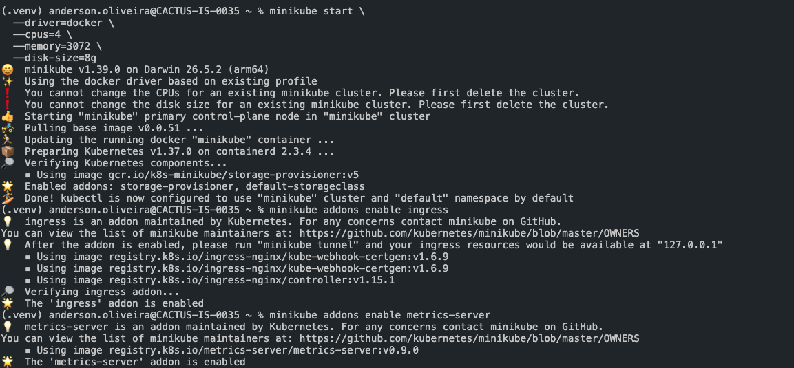

**19/11/2026 18:11:53** — Nó de controle em `Ready` após a ativação do Metrics Server.

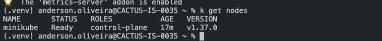

**19/11/2026 18:12:18** — IngressClass Nginx presente no perfil original, antes da consolidação do acesso com Traefik.

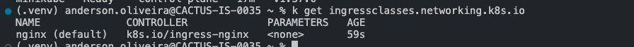

**19/11/2026 18:12:57** — Coleta inicial de CPU e memória com `kubectl top node`.

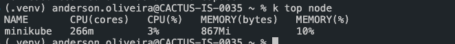

## 2. Argo CD e projetos

Ver 6 capturas

**19/11/2026 18:47:46** — Configuração inicial do repositório Helm do Argo CD.

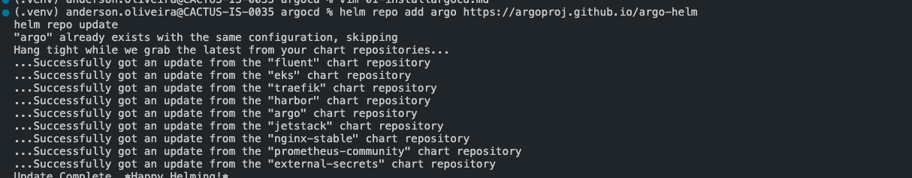

**19/11/2026 18:54:10** — Criação das pastas `projects` e `bootstrap` durante a organização do GitOps.

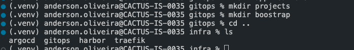

**19/11/2026 19:17:58** — Definição do AppProject `platform-registry` para o Harbor.

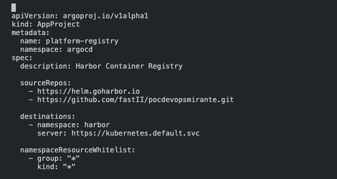

**20/11/2026 15:47:30** — Repositório Git com status de conexão bem-sucedida na interface do Argo CD.

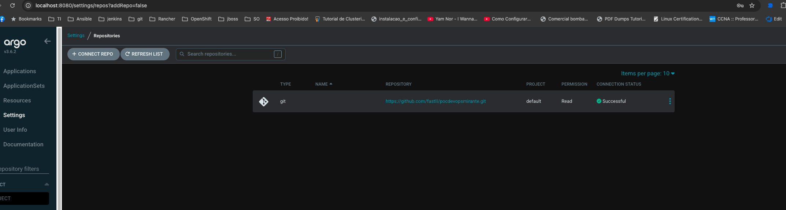

**20/11/2026 15:54:04** — Inventário de AppProjects e Applications. O `platform-root` já aparecia nesse momento, após as primeiras etapas da instalação.

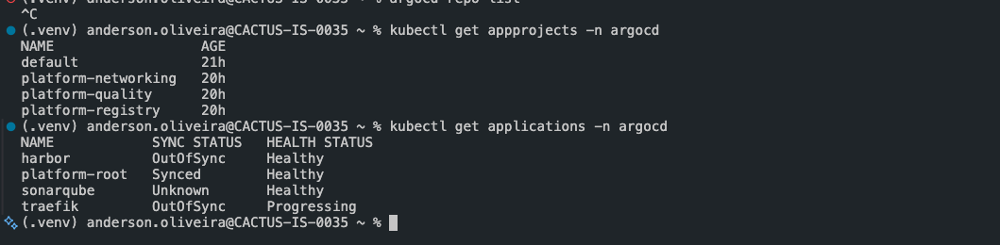

**20/11/2026 18:09:33** — Upgrade do release Helm do Argo CD.

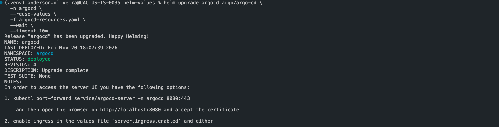

## 3. Gateway API, TLS e Traefik

Ver 11 capturas

**19/11/2026 18:27:23** — Aplicação dos CRDs Standard da Gateway API.

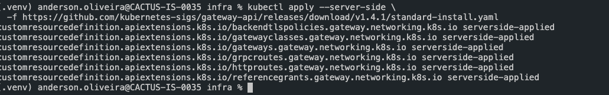

**19/11/2026 18:27:51** — Instalação inicial do Traefik por Helm.

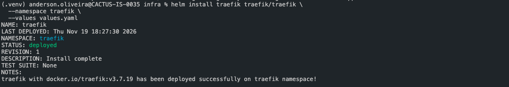

**19/11/2026 18:28:05** — Pods do sistema e do Traefik após a instalação.

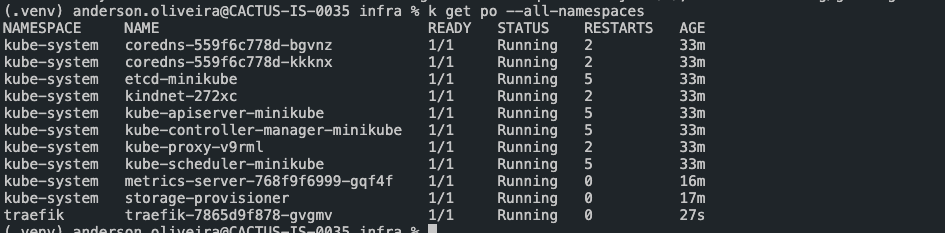

**20/11/2026 14:49:18** — Inventário do Secret TLS no namespace `traefik`.

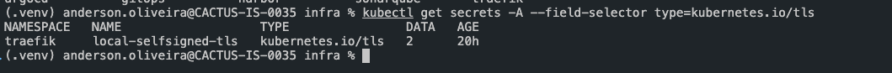

**20/11/2026 14:58:10** — Geração do certificado autoassinado e inspeção do certificado público e do SAN.

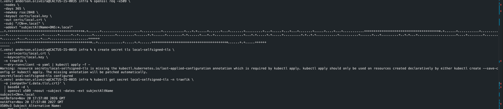

**20/11/2026 18:25:44** — Aplicação individual dos HTTPRoutes de Argo CD, Harbor e SonarQube.

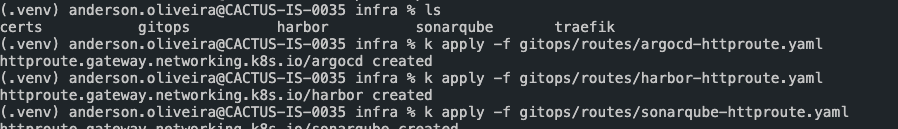

**20/11/2026 18:25:56** — Registro da Application `platform-routes`.

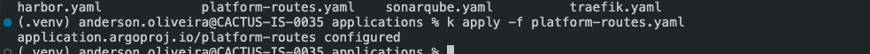

**20/11/2026 18:47:35** — Logs de inicialização do Traefik durante o diagnóstico da Gateway API.

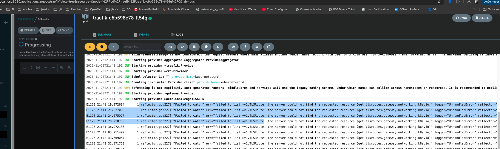

**20/11/2026 18:48:28** — Inventário das APIs e das versões da Gateway API.

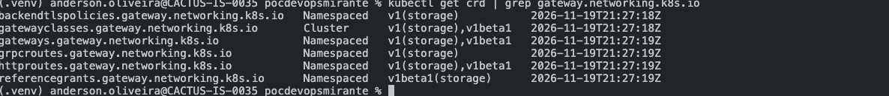

**20/11/2026 19:07:31** — Backup dos CRDs e aplicação do bundle Experimental 1.4.1 durante a recuperação original.

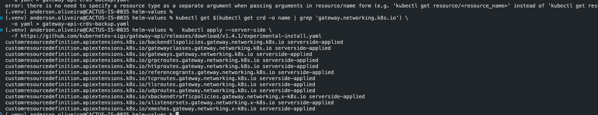

**20/11/2026 19:58:16** — Resposta HTTP 404 no acesso local durante o diagnóstico de rota.

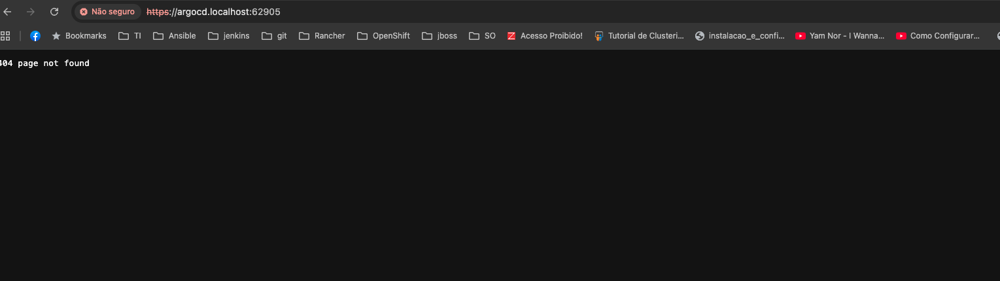

## 4. Harbor e SonarQube

Ver 6 capturas

**19/11/2026 18:34:20** — Preparação da pasta e dos values iniciais do Harbor.

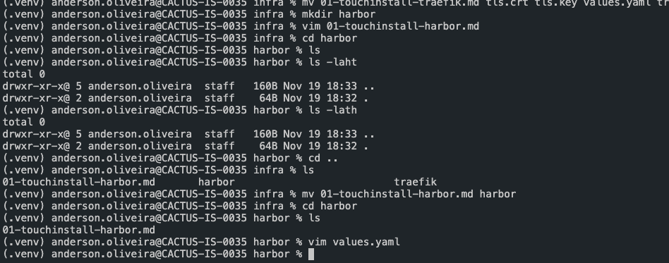

**19/11/2026 18:35:35** — Consulta de versões do chart Harbor.

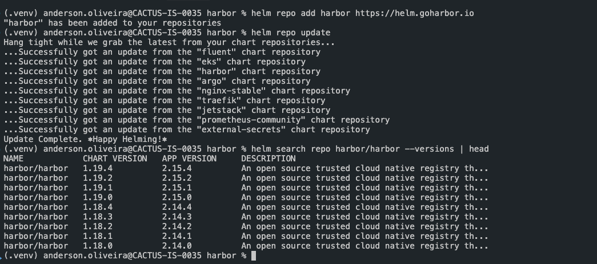

**19/11/2026 18:39:02** — Pods, Services e Deployments do Harbor. O Trivy constava na instalação original.

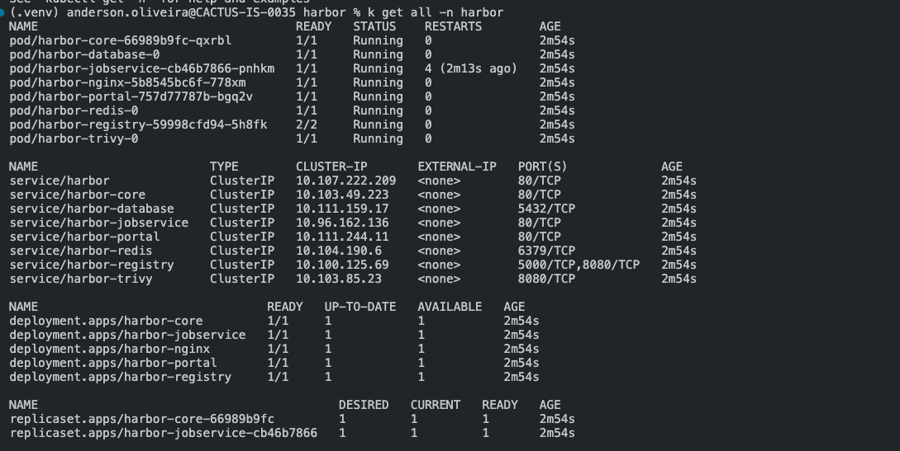

**19/11/2026 18:39:17** — PVCs do Harbor em `Bound`.

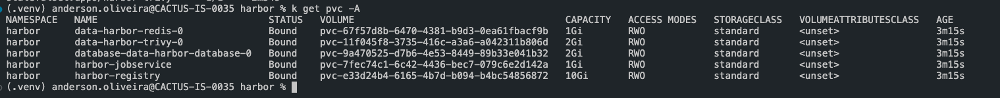

**20/11/2026 14:20:31** — Consulta de versões do chart SonarQube.

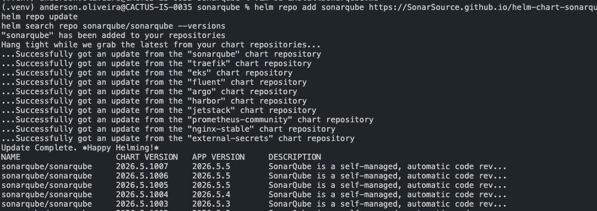

**20/11/2026 14:31:44** — Renderização de StatefulSets em uma versão anterior do chart. A captura não descreve a configuração de banco atual.

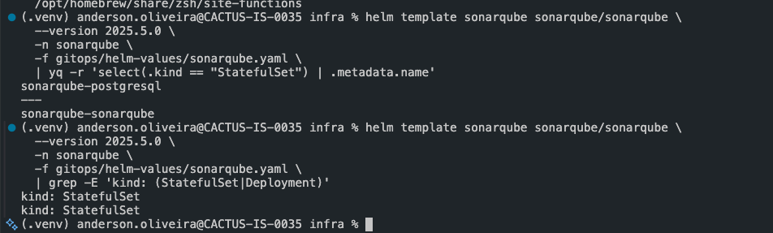

## 5. Kyverno e políticas

Ver 3 capturas

**21/11/2026 10:58:59** — Consulta do chart Kyverno e da versão selecionada.

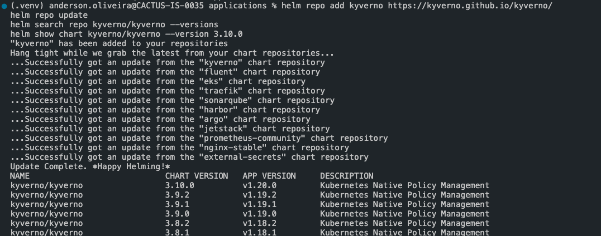

**21/11/2026 11:01:30** — Dry-run dos manifests e criação individual do AppProject e da Application.

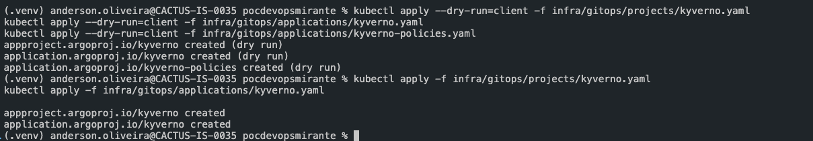

**21/11/2026 11:01:53** — O job `kyverno-check-legacy-policies` terminou em `Completed`. O `kubectl get pods -w` ainda estava ativo, então a imagem não mostra as verificações seguintes de Deployments, CRDs e webhooks.

## 6. ARC e GitHub Actions

Ver 3 capturas

**21/11/2026 11:17:57** — O workflow pediu o runner `arc-minikube` e estava na fila. Esta captura registra a espera, sem confirmar a execução do job.

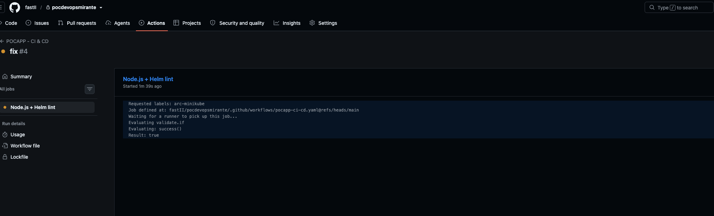

**21/11/2026 22:17:38** — Registro de um runner self-hosted no macOS ARM64 que chegou a `Listening for Jobs`. Esse runner local é distinto do scale set ARC no Kubernetes.

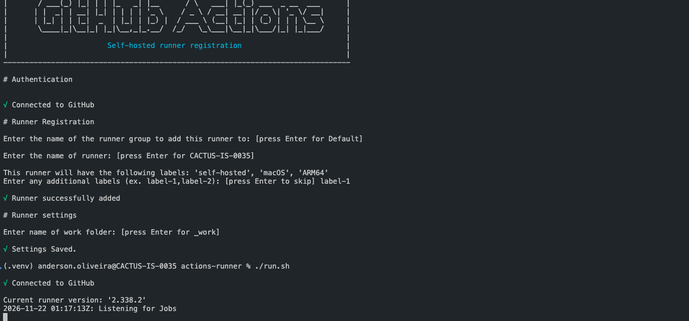

**21/11/2026 22:18:16** — Tela do GitHub com a configuração de um runner self-hosted para macOS ARM64. A captura foi recortada e complementa o registro do terminal acima.

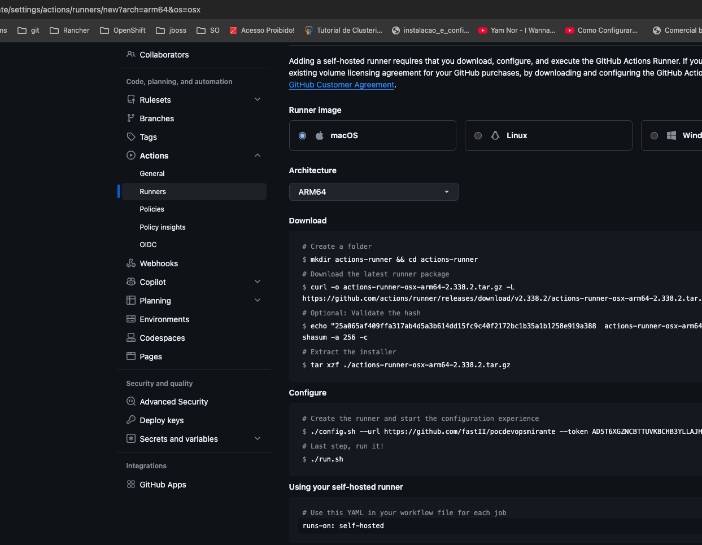

## 7. POCAPP

Ver 6 capturas

**19/11/2026 18:17:39** — Criação e estrutura inicial do chart `helm/pocapp`.

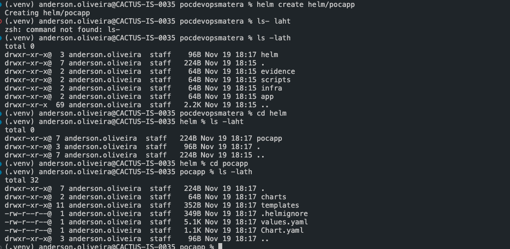

**21/11/2026 09:54:29** — API Node.js iniciada localmente na porta 3000.

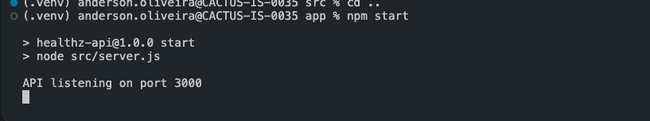

**21/11/2026 09:55:00** — Endpoint `/healthz` da API local com HTTP 200 e `status: healthy`.

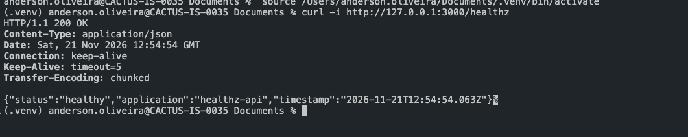

**21/11/2026 21:30:43** — Aplicação individual do AppProject `pocapp`. A captura registra uma configuração histórica; use o manifesto do repositório como referência.

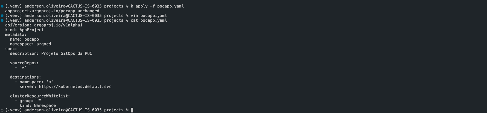

**22/11/2026 17:28:39** — Execução nº 49 concluída com sucesso da validação Node.js e Helm à atualização GitOps. [Execução no GitHub Actions](https://github.com/fastII/pocdevopsmirante/actions/runs/45063520671)

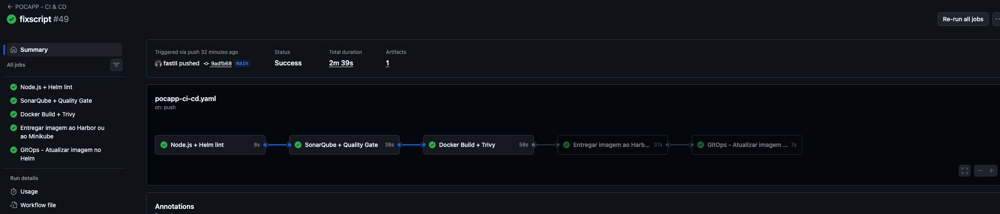

**22/11/2026 17:36:57** — A aba **Summary** mostra os seis jobs em verde, a imagem entregue ao Harbor para a versão estável e a revisão GitOps `4e6054b43b59`.

## 8. Observabilidade

Ver 5 capturas

**20/11/2026 21:23:16** — Criação do namespace `observability` e do Secret do Grafana com entrada oculta da senha.

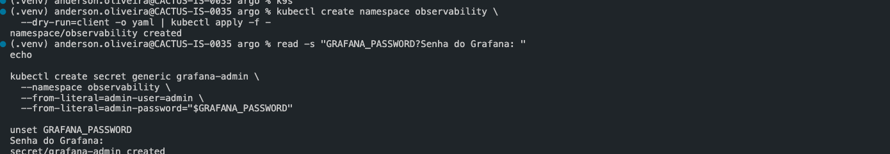

**20/11/2026 21:23:29** — Criação do AppProject e das Applications de Prometheus, Loki e Alloy.

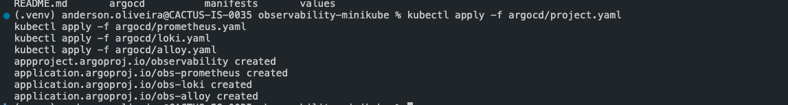

**20/11/2026 21:23:53** — Criação da Application da rota do Grafana após registrar os componentes.

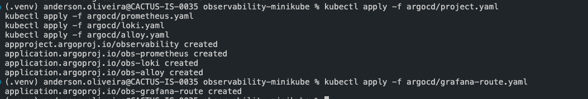

**22/11/2026 16:38:41** — Grafana com as métricas de CPU e memória do namespace `observability`, coletadas pelo Prometheus.

**22/11/2026 16:40:39** — Grafana consultando no Loki os logs do namespace `traefik`.

## 9. Incidentes de provisionamento

Ver 3 capturas

**20/11/2026 17:32:53** — Tentativa de acessar a API e retomada do perfil Minikube existente.

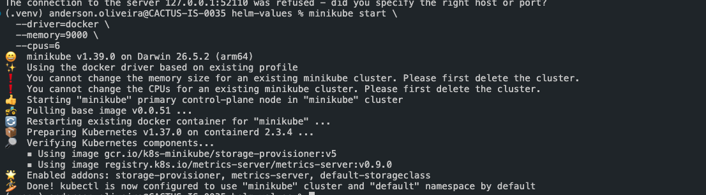

**21/11/2026 08:05:25** — Falha do check de prontidão do API Server durante o incidente.

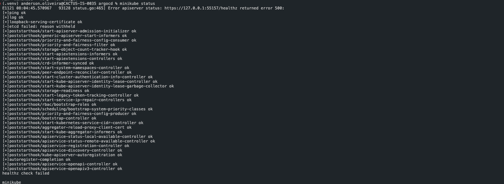

**21/11/2026 09:21:15** — Aumento do limite de CPU e checagem de prontidão do API Server durante o contorno.

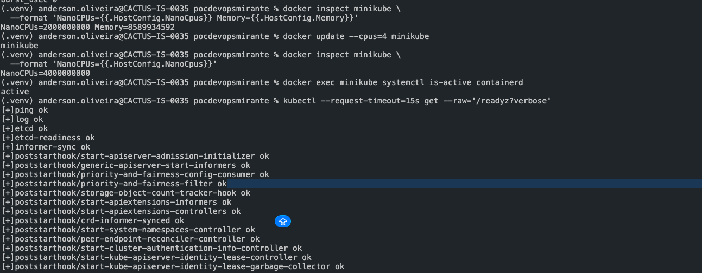

[Diagnóstico e contornos](Dificuldades.md) · [Procedimento de rollback](Processorollback.md)
