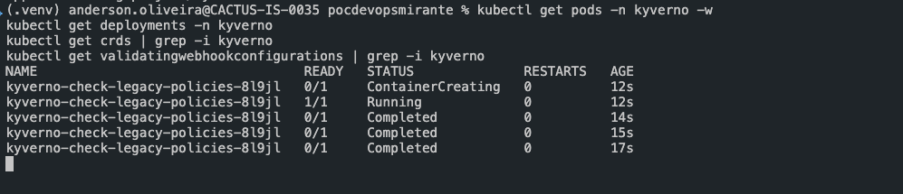

# Evidências do provisionamento original

[Voltar ao runbook](../RUNBOOK.md)

Na instalação original, as Applications foram provisionadas individualmente pelo Argo CD. O `platform-root` e o script descrevem o fluxo de reprodução da POC. As capturas desta página registram a instalação original.

## Ordem para registrar as capturas

| Ordem | Etapa | O que a evidência deve mostrar |
| --- | --- | --- |
| 1 | Minikube | Nó `Ready` e contexto do cluster |
| 2 | Argo CD | Pods disponíveis e acesso ao serviço |
| 3 | Certificado, Gateway API e Traefik | Gateway programado e listener HTTPS |
| 4 | Harbor e SonarQube | Applications, serviços e PVCs |
| 5 | Kyverno e políticas | Job de instalação, controladores, CRDs e política |
| 6 | ARC | Controller, listener e execução de um runner |
| 7 | POCAPP e CI/CD | Imagem no Harbor, Deployment e resposta de `/healthz` |
| 8 | Observabilidade | Grafana, métricas do Prometheus e logs do Loki |

### 5.1 Kyverno · Job de verificação de políticas legadas

Captura de 21/11/2026 às 11:01. O `Completed` mostra que o job de verificação de políticas legadas terminou. O comando `kubectl get pods -n kyverno -w` ainda estava acompanhando os pods. A captura registra essa etapa do sync e não mostra a saída das verificações seguintes de Deployments, CRDs e webhooks. [Validação do Kyverno](../infra/kyverno/01-install-kyverno.md)

Para incidentes e recuperação, consulte [Dificuldades](Dificuldades.md) e [Rollback](Processorollback.md).
